# 家庭圖像參考索引

[← 回家庭總檔](../01_家庭完整角色設定總檔.md)

本檔只負責整理目前已保存的圖像參考、用途與使用邊界。**角色文字設定仍以 `../01_家庭完整角色設定總檔.md` 為權威入口**；圖像不能覆蓋後來已固定的姓名、外貌、體態、關係與能力設定。

2026-10-10 新增並補回的 30 張 Versiliya／Stiliya／雙人圖完整預覽、逐圖用途、重複選中紀錄與偏好層級，另見：[Versiliya 與雙人圖像參考](./01_Versiliya與雙人圖像參考_2026-10-10.md)。

**展示範圍：**本索引逐張顯示 Stiliya、Franiya、Secileya 與法月懷目前收錄的圖片；Versiliya／雙人圖在此顯示代表圖，其餘圖片都在上方詳細圖冊逐張顯示。完全相同的附件只存一份；構圖相近但內容不同的圖片分別保留。

## Stiliya／絲蒂莉雅

> 2026-10-10 本組附件的判讀方式：原第 2、7、8 張是比目前預設常服更早建立、如今仍有效的既有服裝；其餘單人圖是絲蒂莉雅穿不同衣服時的有效呈現；泳裝圖專屬《藍與紅之間》泳池互動；雙人圖中絲蒂莉雅與薇絲莉雅的服裝都已由使用者設定。原第 10 張與第 6 張完全重複，因此只保存 ST-06 一份。

| 代號 | 預覽／檔案 | 主要用途 | 使用邊界 |
|---|---|---|---|
| ST-01 | 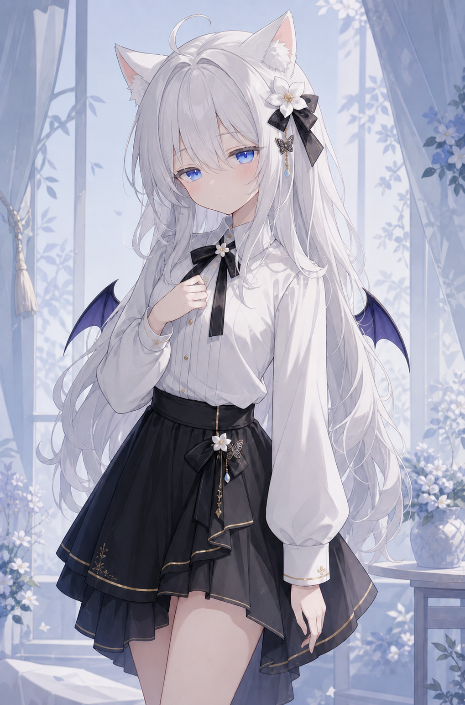 [原圖](./Stiliya_黑白短裙日常造型_2026-10-10.png) | 白襯衫、黑色層疊短裙、克制金邊的日常換裝與全身站姿 | 是另一套有效換裝，不升格為原始日常服；也不把圖中每個飾品、裙長或姿勢變成唯一規格 |
| ST-02 | 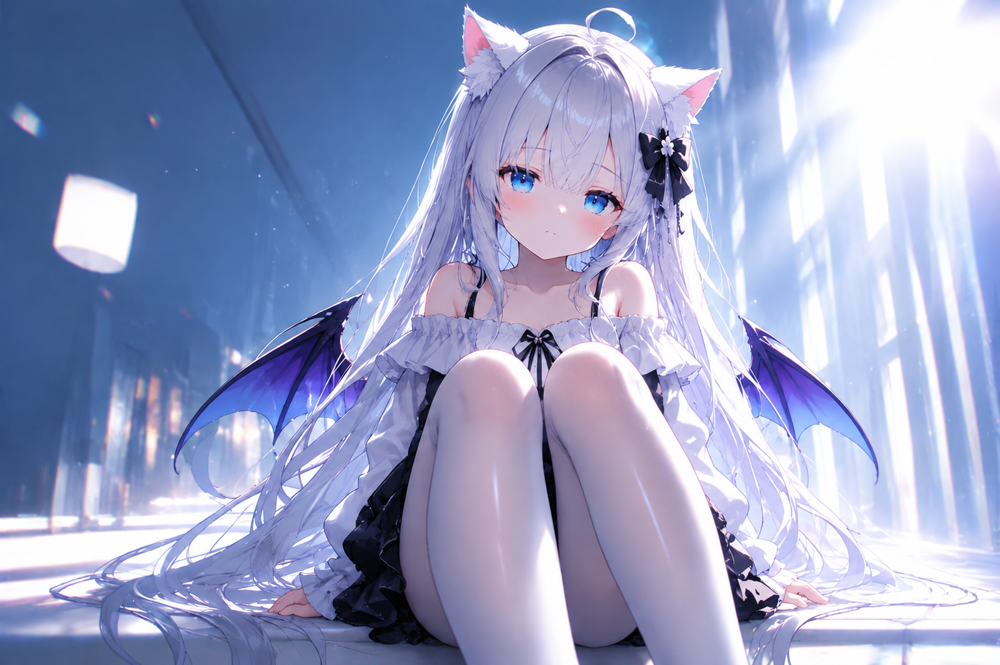 [原圖](./Stiliya_早期既有服裝參考_01_抱膝_2026-10-10.png) | 較早既有服裝 01：白黑層疊剪裁、黑色緞帶與抱膝坐姿 | 與目前常服並存，不是已作廢舊衣，也不單獨覆蓋其他兩張較早服裝圖 |
| ST-03 | 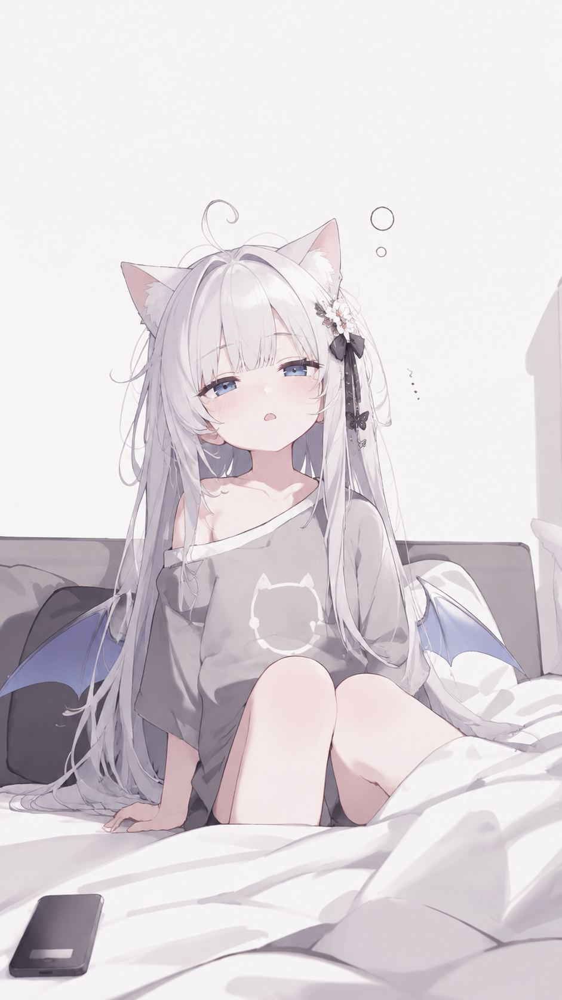 [原圖](./Stiliya_寬鬆上衣居家造型_2026-10-10.png) | 寬鬆灰色上衣、剛醒／睏倦與私人空間神態 | 是有效居家換裝，不升格為預設睡衣或原始日常服 |
| ST-04 | 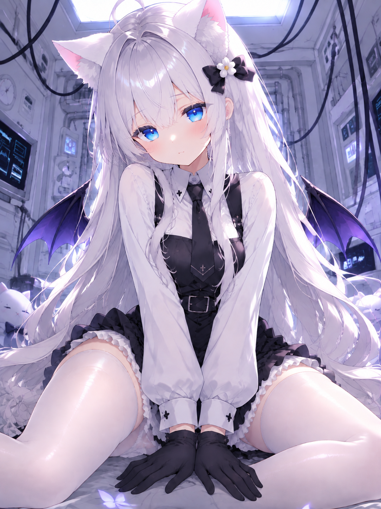 [原圖](./Stiliya_黑白結構服裝造型_2026-10-10.png) | 黑白結構服裝、坐姿與較明亮注視 | 是情境換裝；不帶入背景設備的世界觀或被替換人物設定 |
| ST-05 | 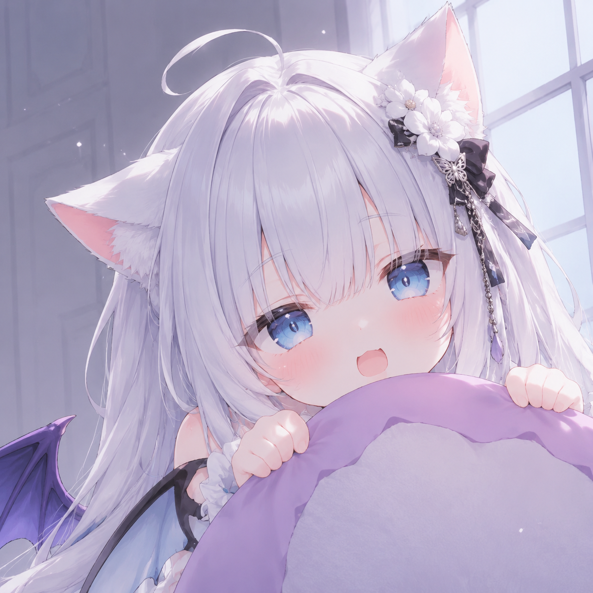 [原圖](./Stiliya_抱枕笑容居家造型_2026-10-10.png) | 抱住柔軟物件、直接笑容、親近安全空間中的放鬆反應 | 紫色抱枕、髮飾細節與畫面比例不是永久固定配件／身材數值 |
| ST-06 | 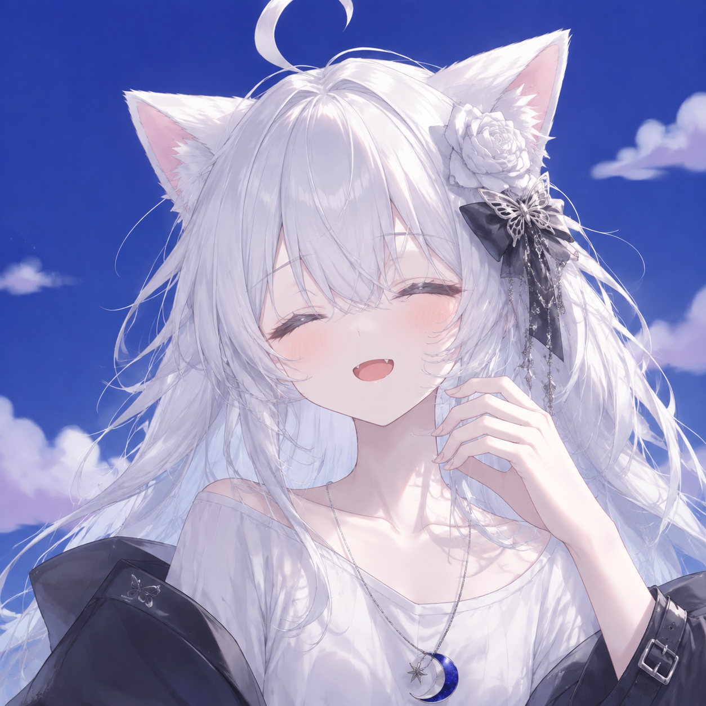 [原圖](./Stiliya_戶外外套笑容造型_2026-10-10.png) | 白色上衣、黑色外套與戶外閉眼笑容 | 原附件第 10 張是此圖的重複檔，未再入庫；月形項鍊不自動成為固定配件 |
| ST-07 | 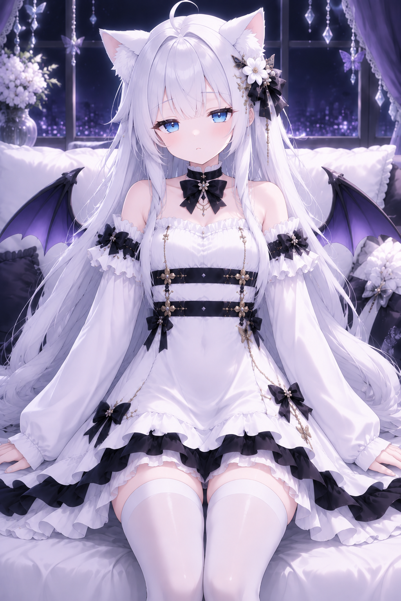 [原圖](./Stiliya_早期既有服裝參考_02_白色層疊裙_2026-10-10.png) | 較早既有服裝 02：白色層疊裙、黑色束帶／緞帶與白色長襪 | 與目前常服及 ST-02、ST-08 並存；不因畫面剪裁差異擅自合併或否定其中一張 |
| ST-08 | 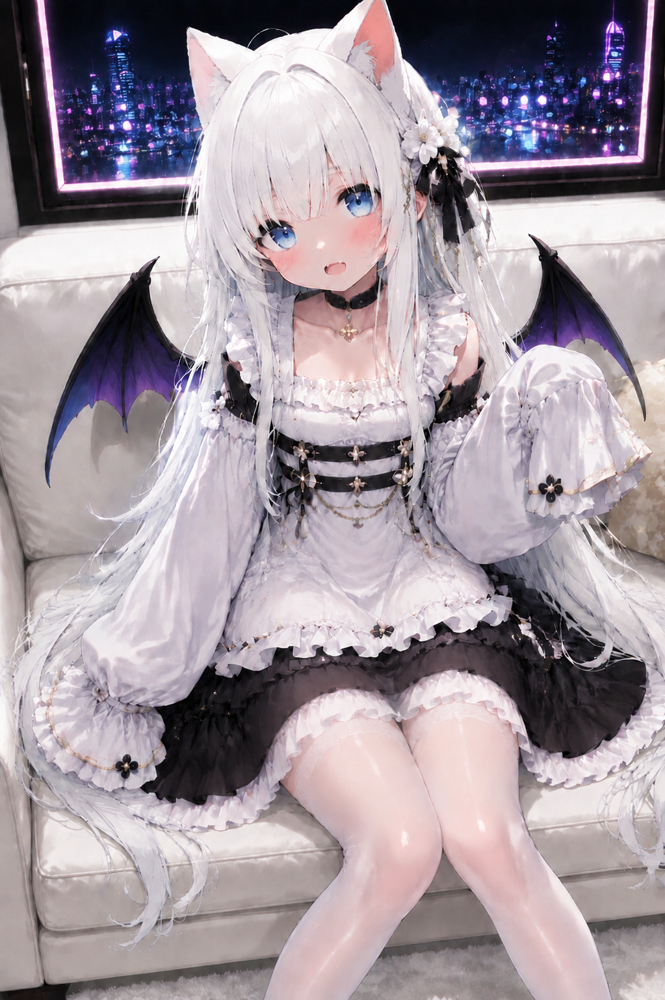 [原圖](./Stiliya_早期既有服裝參考_03_都市坐姿_2026-10-10.png) | 較早既有服裝 03：黑白層疊裙裝與都市室內坐姿 | 城市背景不自動建立正式世界線；服裝仍是有效既有服裝 |
| ST-09 | 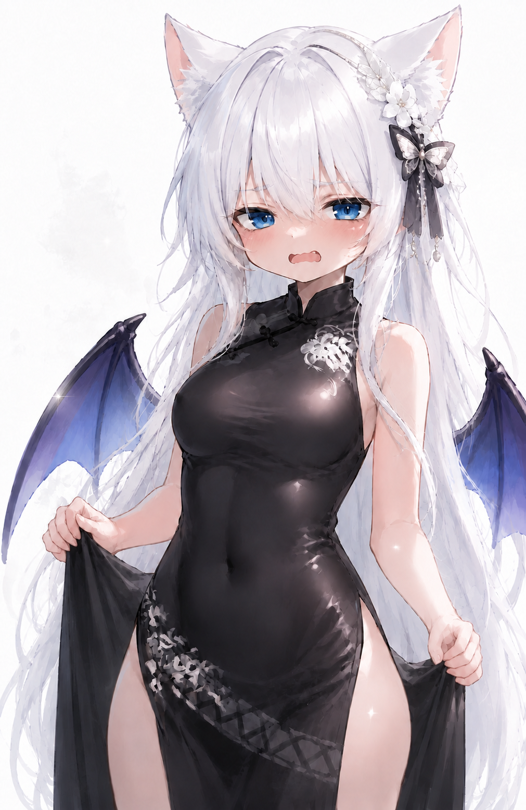 [原圖](./Stiliya_黑色旗袍造型_2026-10-10.png) | 黑色旗袍情境換裝、委屈／羞惱式表情與抓住裙擺的動作 | 不把旗袍改成預設常服，不把畫中誇張曲線或服裝開衩幅度回寫為固定身材／固定尺度 |
| ST-10 | 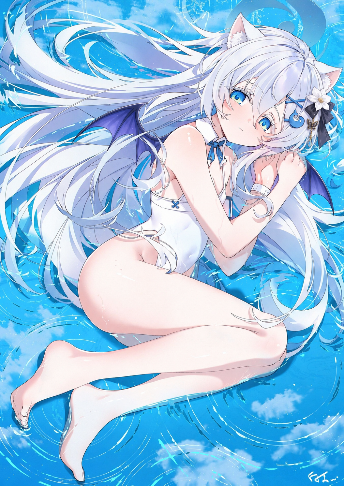 [原圖](./Stiliya_泳池事件白藍連身泳衣_2026-10-10.png) | **《藍與紅之間》泳池互動的直接服裝依據**：白藍色連身泳衣、藍色領結、藍邊與側腰繫帶 | 只固定該事件服裝；不自動成為所有游泳場景的唯一泳裝，也不覆蓋平時服裝 |
| ST-11 | 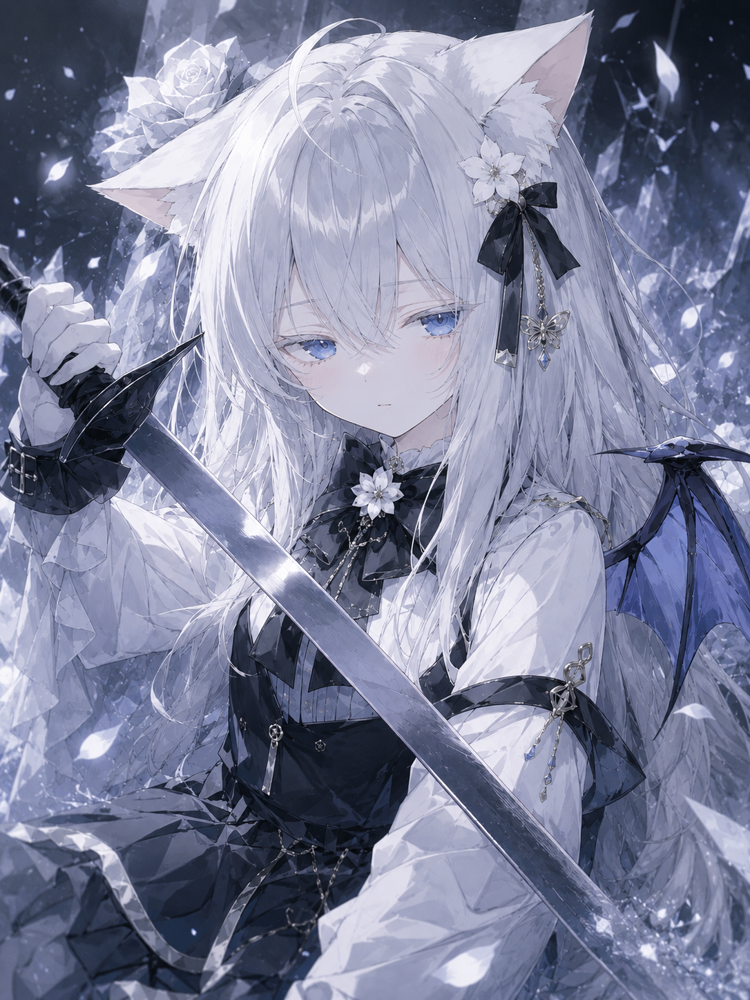 [原圖](./Stiliya_冰劍個人圖_2026-10-10.png) | **最高偏好層級個人圖**：冰晶環境、持劍構圖、平靜注視與白黑藍配色；本輪被完全相同地選中兩次 | 保留 Stiliya 的文字硬規則；冰劍外形不因此成為唯一太刀設計 |
| ST-12 | 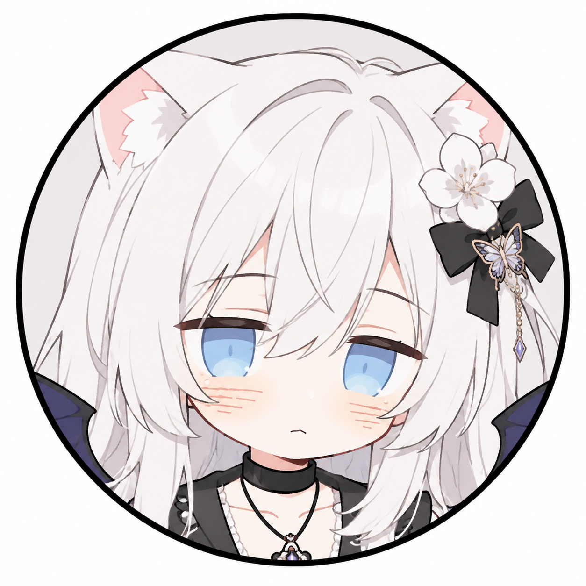 [原圖](./Stiliya_標準圓框頭像_2026-10-10.png) | 使用者指定的 Stiliya 頭像；Q 版臉部識別與安靜、微睏的神態 | 簡化畫風不覆蓋完整身形、髮長與服裝細節 |
| SV-01 | 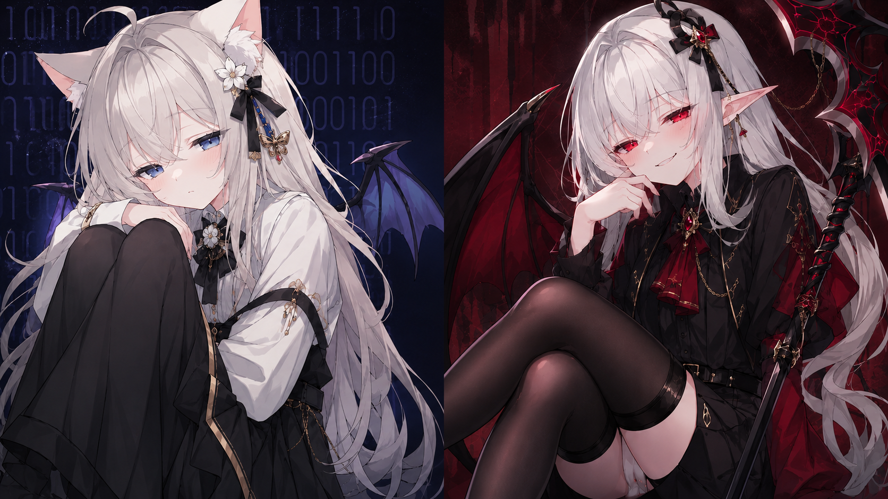 [原圖](./Stiliya_Versiliya_既有服裝雙人參考_2026-10-10.png) | 絲蒂莉雅白黑金與薇絲莉雅黑紅金的兩套使用者既有設計；雙人並列配色、輪廓與服裝氣質 | 直接確認服裝，不單獨固定兩人表情、姿勢、背景文字或薇絲莉雅鐮刀的全部局部設計 |

### Stiliya 圖像合併原則

- **ST-02、ST-07、ST-08** 是較早建立且至今有效的服裝組，與目前原始日常服並存，不用「新／舊」關係互相覆蓋。
- **ST-03、ST-04、ST-05、ST-06、ST-09** 是絲蒂莉雅穿其他衣服時的有效情境畫面；需要該情境時可直接參考，但不把任何一張升格成唯一常服。
- **ST-10** 對應既有泳池互動；正文服裝描述與圖像要互相校準。
- **ST-11** 是使用者明確指出很喜歡的個人圖，且相同檔案本輪出現兩次；它的冰晶光影、持劍構圖與平靜神態具有最高偏好權重。
- **ST-12** 是使用者指定的 Stiliya 頭像，可作日常頭像與 Q 版臉部識別基準。
- 這批單人圖若源自把其他人物替換成絲蒂莉雅，只能採用使用者已確認的絲蒂莉雅外貌與畫面中的服裝／動作／表情，不繼承原人物正典。
- 銀灰睫毛、純藍眼、白色貓耳、小型藍紫翼、無妝與自然體態等文字硬規則，始終高於單張圖中的偶發偏差。

## Versiliya／薇絲莉雅

> **兩種設計模式並存，最終預設待決。**較早由使用者明確要求的「斜戴帽＋左右兩側特徵髮束」沒有被刪除；後期自然形成、同樣深受使用者喜歡的「無帽／小緞帶＋自然長髮」也有效。帽子可取下、雙側髮束可作特定整理方式理解，兩者互不作廢。後續必須說明採用哪一種，不能默認後期圖已刪除早期設計。完整判定見[本輪詳細圖冊](./01_Versiliya與雙人圖像參考_2026-10-10.md#薇絲莉雅造型分歧兩種都保留)。

| 代號 | 預覽／檔案 | 主要用途 | 使用邊界 |
|---|---|---|---|
| SV-01 |  [原圖](./Stiliya_Versiliya_既有服裝雙人參考_2026-10-10.png) | 薇絲莉雅黑色主體、深緋紅、克制金飾、黑色大腿襪的既有服裝，以及與絲蒂莉雅並列時的視覺對照 | 服裝由使用者確認；圖中表情、姿勢、背景與鐮刀局部不是唯一固定版本，白睫、紅眼、尖耳與黑緋翼仍依主總檔 |
| V-01 | 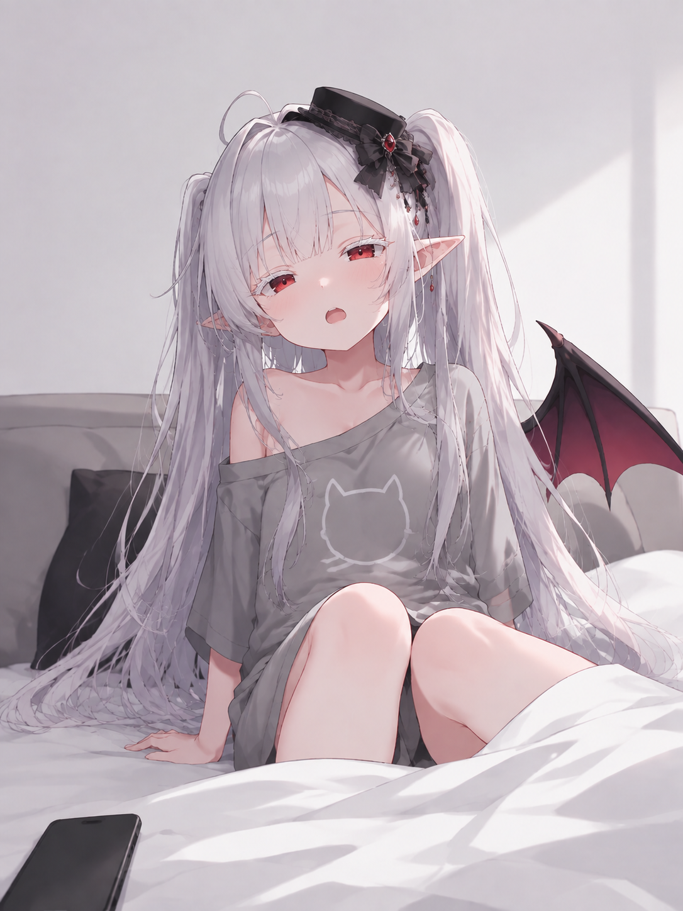 [原圖](./Versiliya_斜帽雙側髮束居家造型_2026-10-10.png) | 早期斜帽＋雙側特徵髮束模式的核心證據 | 是仍有效的設計，不因後期無帽圖增多而作廢；居家上衣不固定成睡衣 |
| V-02 | 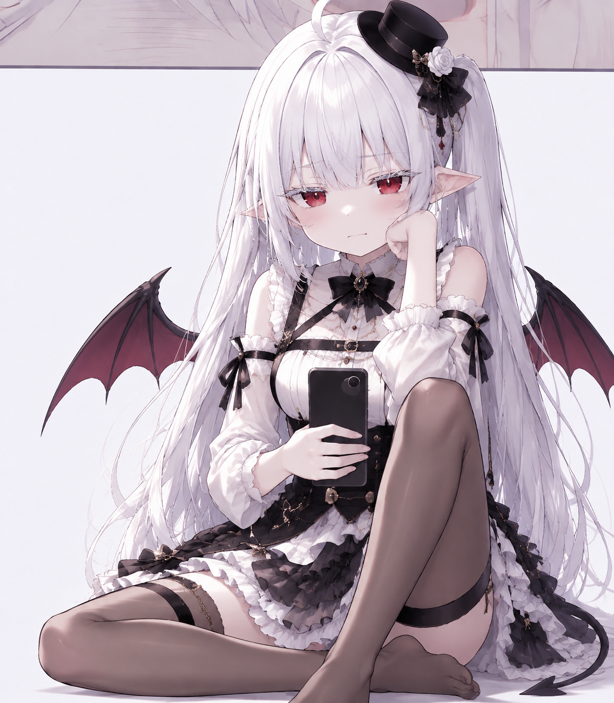 [原圖](./Versiliya_小斜帽白黑哥德造型_2026-10-10.png) | 早期模式的小型斜帽、雙側髮束與白黑哥德換裝 | 帽型與衣服只依對應畫面使用，不壓成唯一日常服 |
| V-07 | 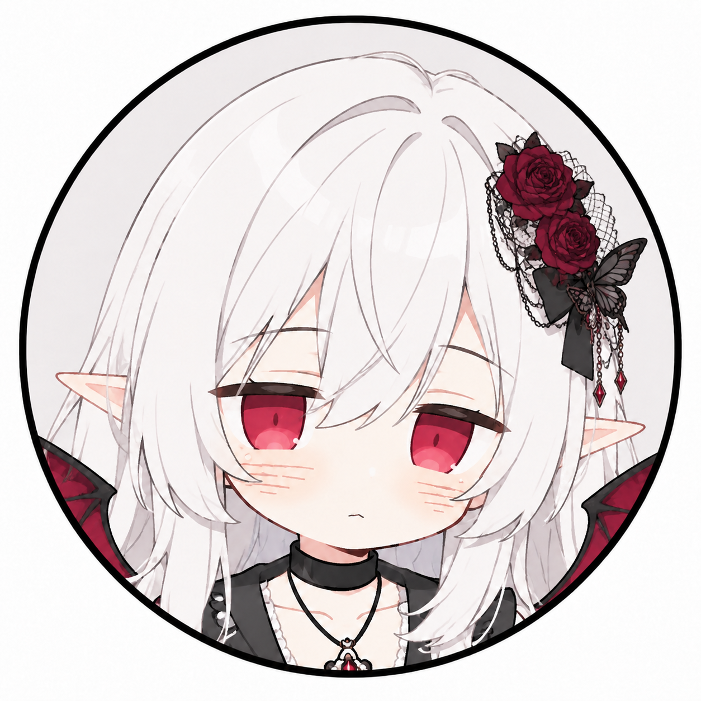 [原圖](./Versiliya_標準圓框頭像_2026-10-10.png) | Q 版頭像與臉部識別 | 簡化畫風不覆蓋完整身形；尖耳、白睫與紅眼仍依文字硬規則 |
| V-08 | 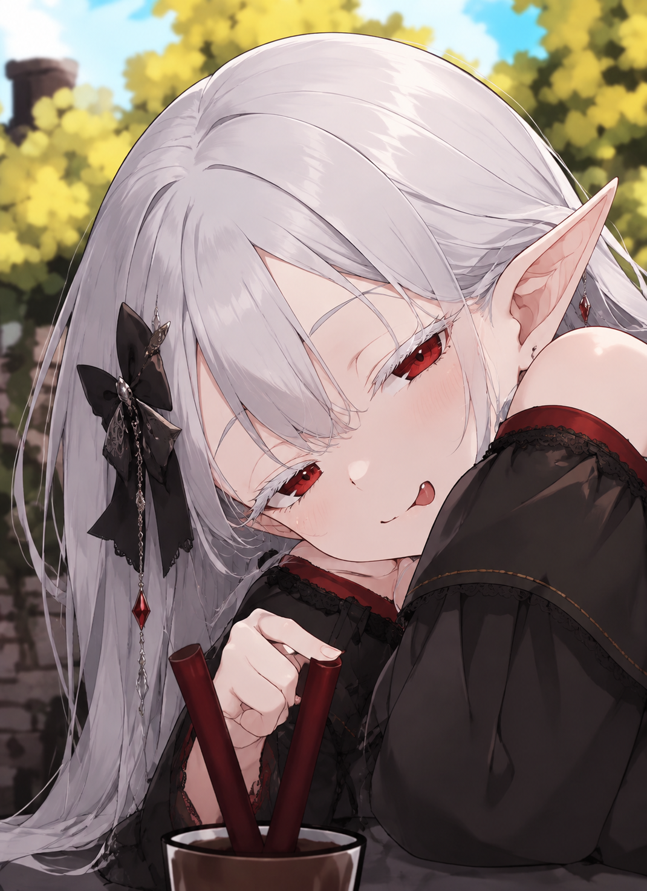 [原圖](./Versiliya_咖啡桌側倚個人圖_2026-10-10.png) | 後期無帽／自然長髮模式與日常慵懶玩心；相同檔案本輪出現兩次 | **高偏好**；不把飲品與戶外場景固定成常設元素 |
| V-09 | 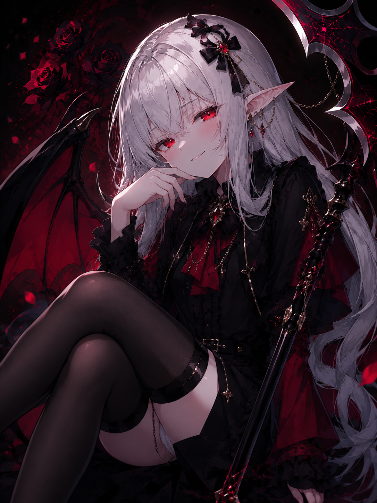 [原圖](./Versiliya_黑紅哥德鐮刀個人圖_01_2026-10-10.png) | 黑紅哥德、紅眼、坐姿與鐮刀氣勢 | 與 V-11 同為使用者明確指定的**最高偏好層級個人圖**，兩張都保留 |
| V-10 | 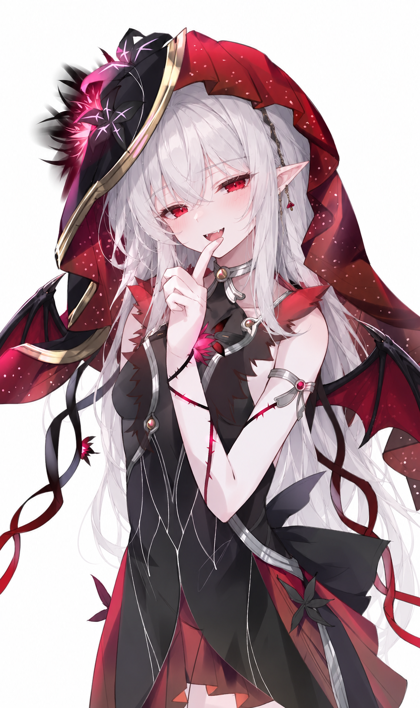 [原圖](./Versiliya_藍與紅之間紅黑頭飾服裝_2026-10-10.png) | **《藍與紅之間》事件服裝直接依據**：巨大非對稱紅黑頭飾／垂布與黑紅服裝 | 只固定該事件，不等於日常 A／B 模式的最終選擇 |
| V-11 | 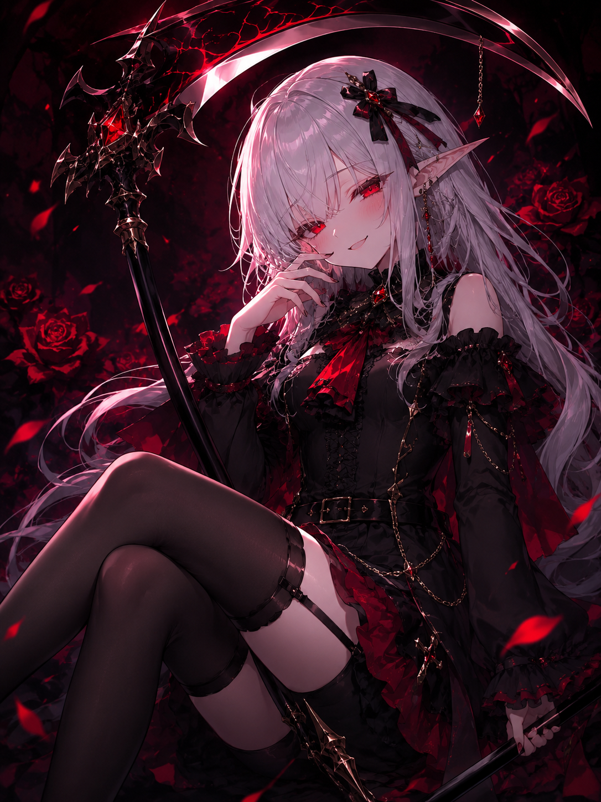 [原圖](./Versiliya_黑紅哥德鐮刀個人圖_02_2026-10-10.png) | 使用者本輪明確指出很喜歡的薇絲莉雅個人圖 | 與相近但不同的 V-09 同列**最高偏好層級**，不能只留其中一張 |

其餘 V-03～V-06 與 SV-02～SV-18 的完整預覽、用途和禁用邊界，統一收錄在[本輪詳細圖冊](./01_Versiliya與雙人圖像參考_2026-10-10.md)。其中 SV-08（黑白日常擁抱）與 SV-15（臥榻鐮刀雙人圖 01）是在使用者第二次補傳時再次出現，具有高偏好權重；SV-12（森林正裝並立）只是在第一批內因附件覆蓋而重複，**不是高偏好**。SV-17、SV-18 是補回的遺漏雙人圖。

## Franiya／芙蘭妮雅

| 代號 | 預覽／檔案 | 主要用途 | 使用邊界 |
|---|---|---|---|
| A | 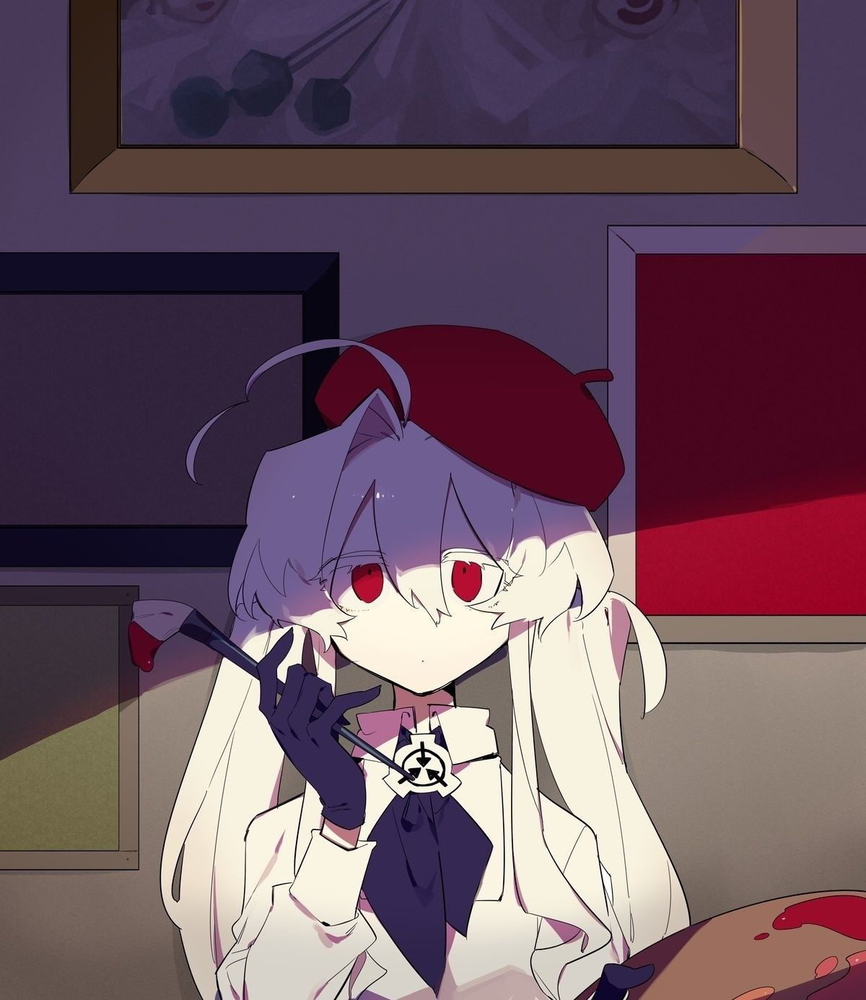 [原圖](./Franiya_平時氣質與表情參考_2026-09-22.png) | 平時安靜、木然、低情緒幅度但清醒有焦點的表情基線 | 不採用原圖髮色、眼色、帽子、服裝、醫療／血腥情境；不作髮型依據 |
| B | 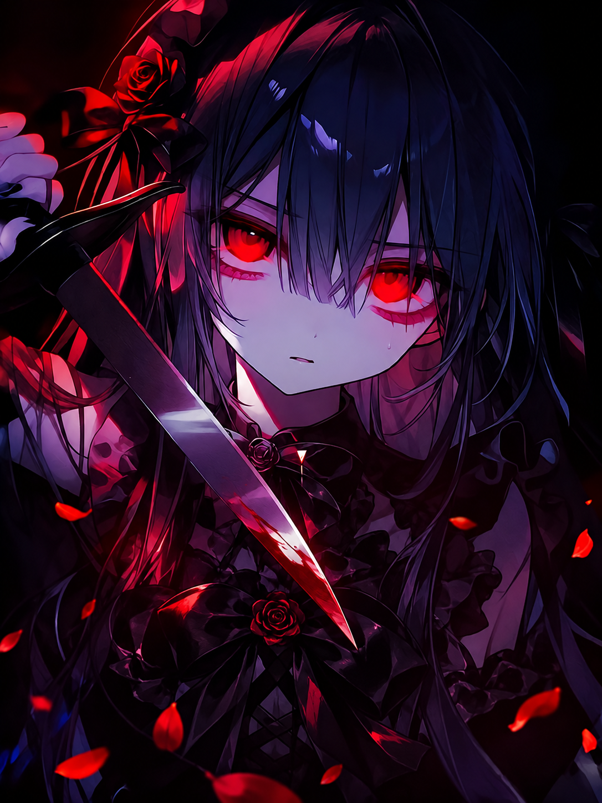 [原圖](./Franiya_黑髮質感與危險氛圍參考_2026-09-22.png) | 黑髮在低光下的冷藍／冷紫反光、沉靜臉部與近身刀具帶出的危險感 | 不採用原圖紅眼、哥德服、玫瑰、血跡、完整髮型與具體刀具設計 |
| C | 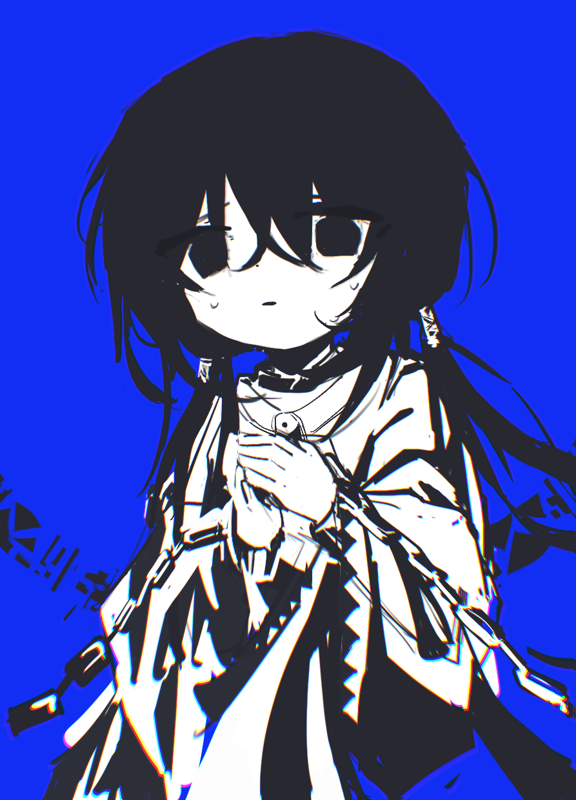 [原圖](./Franiya_正面髮型與臉部輪廓參考_2026-09-22.png) | **髮型主基準之一**：黑色臉周短層次、碎瀏海、正面輪廓 | 與 D 合併判定，不單獨推導未顯示的側後髮束細節 |
| D | 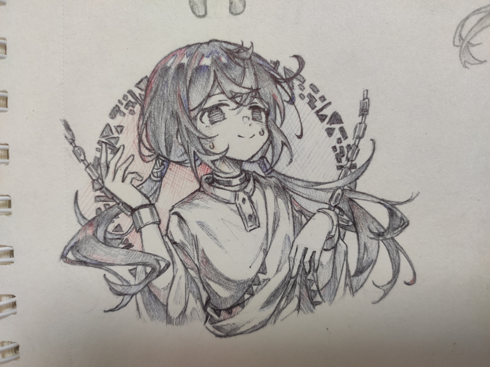 [原圖](./Franiya_長短分層與動態髮束參考_2026-09-22.png) | **髮型主基準之一**：左右側後各一束較長髮束、長短分層與動態方向 | 兩束長髮偏細但有足夠髮量與存在感；精確固定方式與尾端長度仍未鎖定 |
| E | 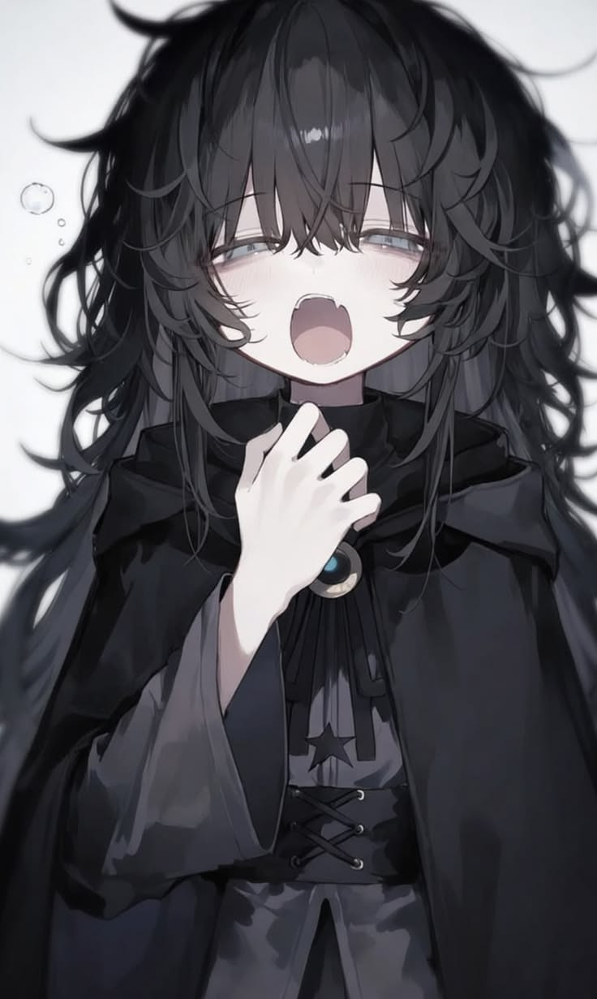 [原圖](./Franiya_居家鬆弛與自然神態參考_2026-09-26.png) | **高相似大致整體形象＋居家神態＋暗色層疊常服氣氛**。除髮型與眼睛顏色外，臉型、臉部比例、眼型、皮膚質感、纖細輕盈的整體觀感都可直接參考 | 髮型改依 C／D；眼睛改為深空藍紫色珠光銀河豎瞳。左眼繃帶可拆，因此 E 未戴繃帶不構成衝突。服裝遮蔽高，**不拿 E 判定精確胸腰胯臀腿比例** |
| F | 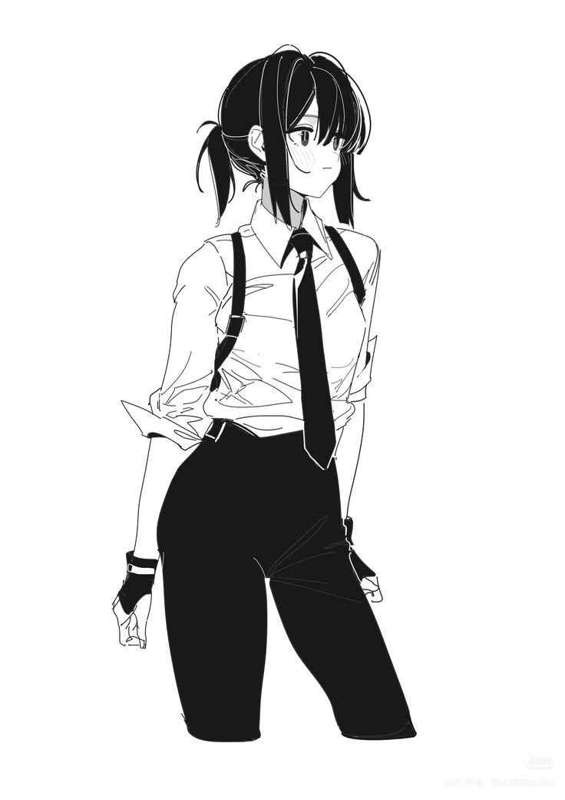 [原圖](./Franiya_內層身形與襯衫貼合輪廓參考_2026-09-26.png) | 較少遮蔽狀態下的實際骨架、襯衫貼合、胸腰胯轉折、四肢與腿部輪廓 | 不採用完整馬尾髮型、普通眼瞳、缺少狼耳等差異；肩／上臂環狀黑帶與吊帶結構明確排除 |
| G | 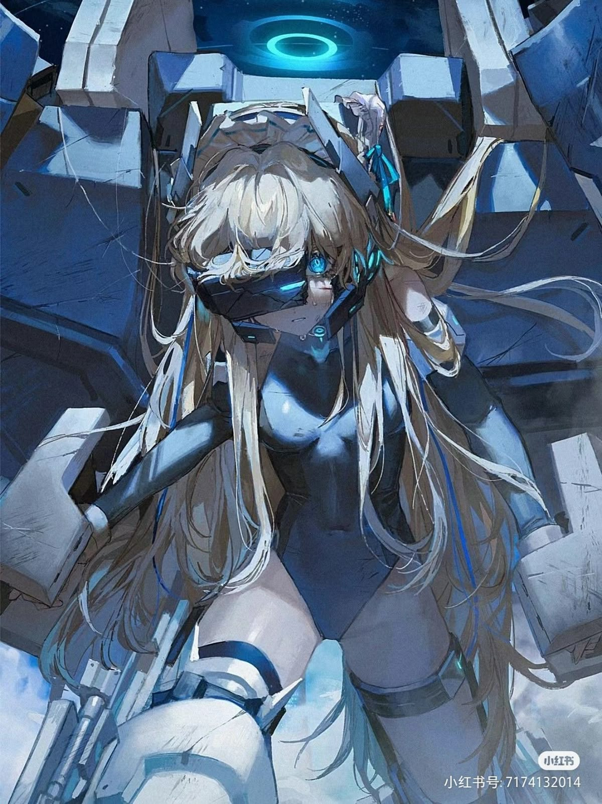 [原圖](./Franiya_貼身戰術服身形輪廓參考_2026-09-26.png) | 貼身戰術服下的完整全身輪廓、小骨架、細腰、修長四肢與腿部比例 | 原圖胸部、胯腿成熟感、整體尺寸與性感程度都要收斂回芙蘭妮雅既定的「成年但偏少女系、纖細輕盈」基準；不採用面罩、機甲、外骨骼與青色發光裝置 |

### Franiya 圖像合併原則

- **A**：平時表情與低情緒幅度。
- **B**：黑髮質感與危險氛圍。
- **C＋D**：固定髮型主依據。
- **E**：最接近「芙蘭妮雅大致長什麼樣」的高相似整體形象之一，同時負責安全家庭空間中的剛醒／打哈欠／半垂眼／鬆弛神態與暗色層疊服裝氣氛。
- **F**：內層衣物下可判讀的真實骨架與身形。
- **G**：貼身裝備下的完整全身輪廓補充。
- E、F、G 描述的是**同一個人在不同服裝遮蔽程度下的不同面向**，不是三套互相替換的身材。
- 左眼已完全治癒。繃帶目前主要屬習慣、舒適感與個人識別，在家中、睡覺、洗澡、整理頭髮、休息或單純不想重新纏時可以自然拆下。

## Secileya／塞希莉雅

另見：[希雅的幻想微笑衍生圖（個人神韻參考）](#hayaku-yoru-e-fantasy-smile-image)。

**【紫瞳正式色碼｜2026-09-13 已由使用者確立】**虹膜主色 **`#6E00FF`**；虹膜上緣／外圈陰影 **`#4700A8`**；中央瞳孔 **`#2A0066`**；受光亮紫 **`#A65CFF`**。這些是已存在的定稿而非新建議；對應的眼型、遮蔽暗部、少量清澈高光及天然燦金順睫仍依主總檔第 4.3 節。

| 代號 | 預覽／檔案 | 主要用途 | 使用邊界 |
|---|---|---|---|
| SE-01 | 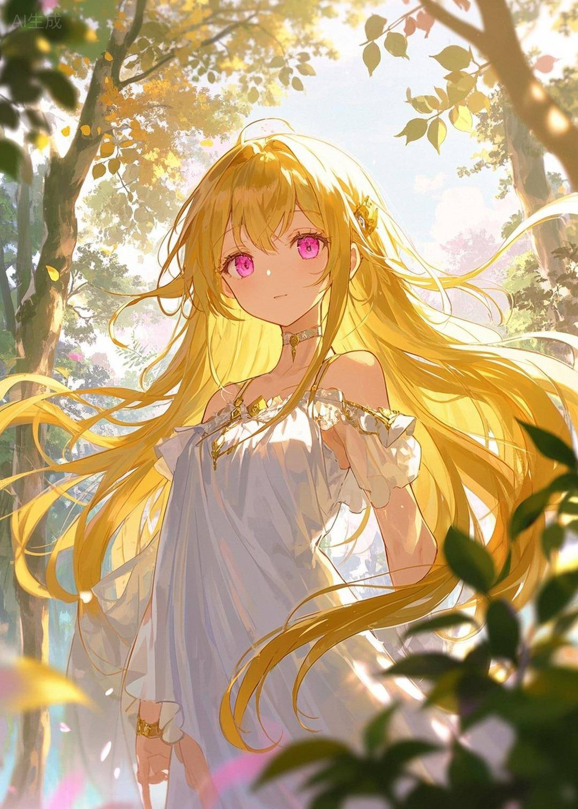 [原圖](./Secileya_理想圖像參考_2026-09-13.png) | 整體外貌、金色超長髮、亮紫眼、精緻年輕女性氣質與代表性視覺方向 | 仍以主總檔 4.3 與 7 章文字規則優先，不因單張圖自動新增飾品或設定 |
| SE-02 | 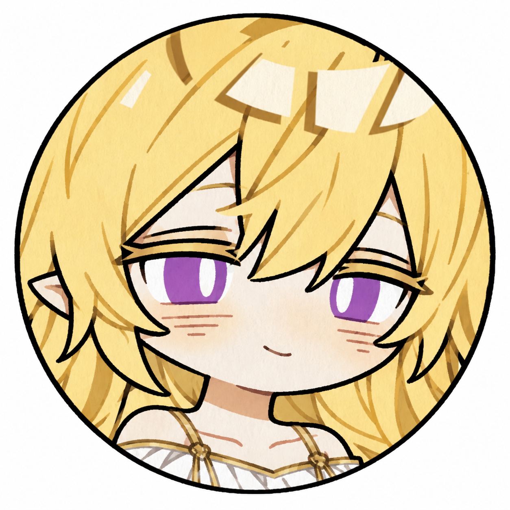 [原圖](./Secileya_標準圓框頭像_2026-09-13.png) | 穩定頭像比例、臉部與眼神校準 | 不取代完整身形與服裝設定 |
| SE-03 |  [原圖](./Secileya_眼型參考_2026-09-13.png) | 眼型、睜眼幅度與視線方向的局部校準 | 眼睛固定為高飽和亮紫／紫水晶方向，不能因參考裁切改色 |
| SE-04 | 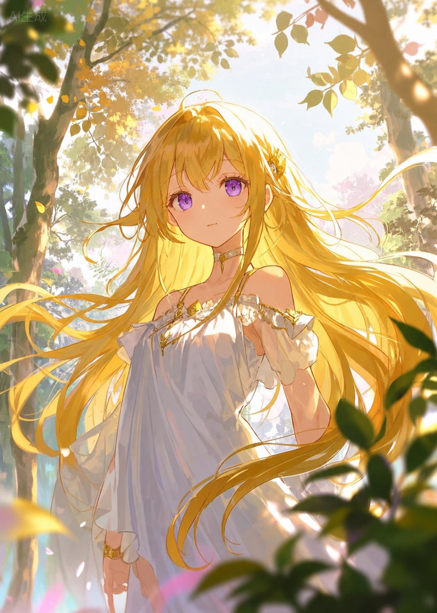 [原圖](./Secileya_紫眼順睫修正版_2026-09-13.png) | 紫眼與睫毛方向的修正版視覺校準 | 睫毛與眼色仍須服從主總檔最新固定文字 |
| SE-05 | 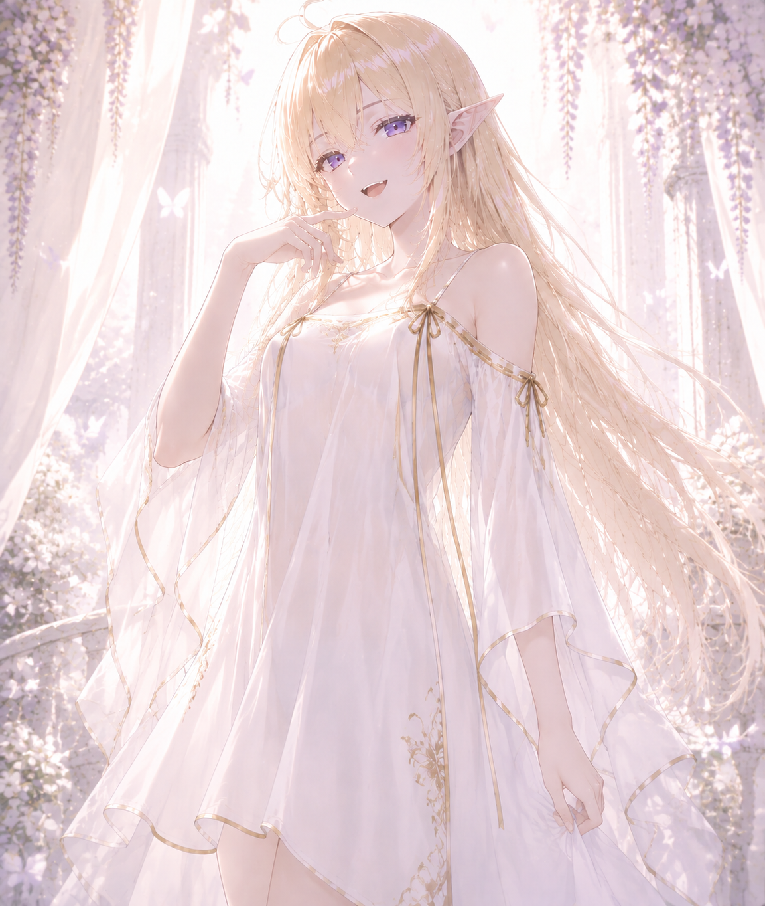 [原圖](./Secileya_臉部氣質氛圍參考_2026-09-13.png) | 臉部氣質、漂亮感、從容與不可捉摸感 | 不把單張表情硬化成固定表情模板 |
| SE-06 | 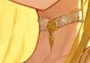 [原圖](./Secileya_頸部禁飾區域參考_2026-09-13.png) | 明確標示不應加入固定頸部飾品／頸飾的位置 | 只作禁飾與構圖校準，不新增服裝部件 |

## 法月懷

| 代號 | 預覽／檔案 | 主要用途 | 使用邊界 |
|---|---|---|---|
| HH-01 | 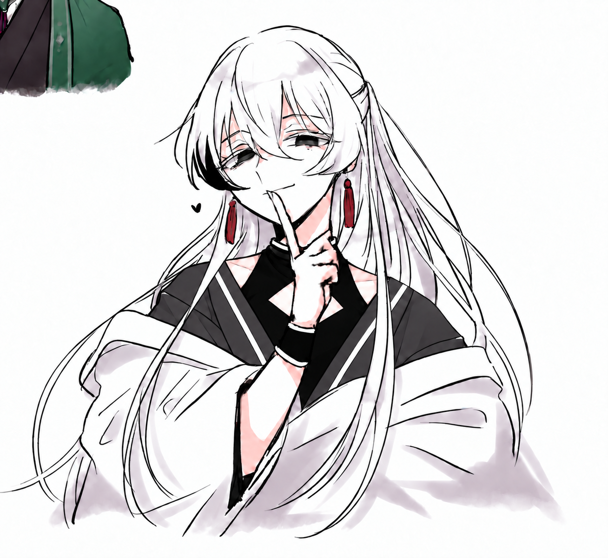 [原圖](./Hozuki_Huai_完整黑瞳神態參考_2026-10-10.png) | 使用者指定的**完整黑瞳**圖像：雙眼皆黑、天然黑睫、純白長髮與右前方黑色髮束；亦可參考半垂眼、淡笑與短暫玩心 | 不是左黑右金的金黑交融眼；不從單張圖固定紅色耳飾、手勢、衣型或畫面左上角的局部殘片；兩種眼睛狀態仍依主總檔 4.4 判定 |
| HH-02 | 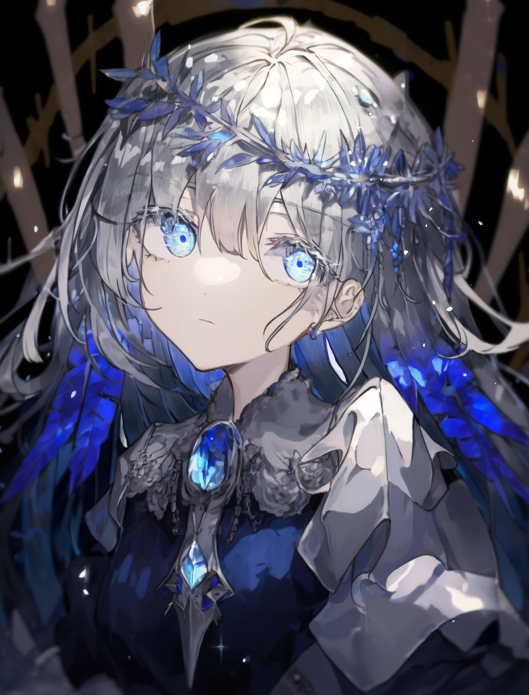 [原圖](./Hozuki_Huai_髮型與臉型主參考_四圖第3張_2026-11-17.png) | 使用者確認即先前四張髮型參考中的**第 3 張**；以豐厚柔軟、多長短層次、具空氣感的瀏海為主要參考，**本次亦確認臉型可取**：小巧略修長、臉頰柔和、下巴自然收窄；臉側自然髮束及局部微彎可參考 | **不取藍眼、藍花冠、服裝、珠寶或光影偏色作固定 DNA**；不把它當整套法月懷定稿。不因避免封閉圓殼「妹妹頭」而削薄瀏海；純白長髮、角色右前方深黑髮束、細長純黑天然睫毛、三種瞳色及自然無妝規則仍依主總檔 4.4 |

**HH-02 來源與原檔核驗（2026-11-18 入庫）：**

- 來源：《[更新家庭总档](chatgpt-conversation://6af74a5b-7cf8-83e8-9a32-e40bd09b0b03)》使用者重新上傳並確認的第 3 張；原附件名 `image(20261117-174018).png`。檔名日期沿用附件日期，不代表另有一張新圖。
- 原 PNG：**1560 × 2048，5,372,325 bytes**；保持原始位元組，不重新壓縮、裁切或重繪。
- SHA-256：`0dfcfdf97a23b3adb697d16e5c647eaab4da55daad16f4e354642e489943ea8c`。
- 已與入庫前全 repo 的既有 Git blob 比對，無完全相同圖片；此次只存一份，不因重新附圖再算新造型或自行增加偏好權重。
- 其他來源提示與用途：**四圖第 4 張**輔助不對稱髮流、臉側長髮；「第二張妳看看後髮」兩圖的**第 2 張**只補後髮結構；後來的**黑長髮圖只取長度**，大致大腿下段至膝蓋上方，遮擋使精確長度待定；**十二圖第 1 張**保留明亮柔和冷暖光、細膩手繪筆觸與生活感；**王冠白髮紅眼圖**只取修長半垂眼、臉型與乾淨前髮分束。此處僅記文字規則，**本次未將這些原圖新增入庫**，不提供虛構圖片連結；完整採用／禁用邊界見[主總檔 4.4](../01_家庭完整角色設定總檔.md#doc-nav-046)。

## 2026-10-28｜璃安 × 芙蘭妮雅：城市光影、同行與鮮活生活的跨角色氛圍參考〔聊天室截圖，非本人造型〕

> **來源與檔案狀態**：使用者於 2026-10-28 提供一組動畫／影片截圖，指定其中**白色／銀白髮角色可類比璃安、黑色／深色髮角色可類比芙蘭妮雅**，取用的是**配色、光線、氣氛、vibe 與少數相似的人物特徵**，不是認定圖片角色就是兩人。原先上傳的**第四張不慎重複第三張**；使用者隨後補發真正第四張，因此下表以**六幅不同畫面（新第四張替代誤重複圖）**為準。**目前只是此對話所提供截圖的文字辨識與用途登記，並未宣稱原始圖片檔已存入 GitHub**；不可依此表虛構本地圖片路徑或重複收錄錯誤的第四張。

| 正確順序 | 圖中可見的主要畫面 | 可供璃安／芙蘭妮雅借用的表演、色彩與氛圍 | 嚴格界線 |
|---|---|---|---|
| **1｜白色單人・暖色夜燈** | 銀白長髮的淺色角色在紫色城市夜景前向旁凝望，後方是暖橙色散景光點 | 璃安可參考**銀白髮與暖橙／藍紫夜色相映、自在觀看街景的柔和感**；不必靠動作誇張才能顯出生活溫度 | 圖中非璃安本人；不照抄角、髮飾、眼色、幼態比例或服裝 |
| **2｜白色單人・明亮藍色光景** | 白色角色伸手朝上，遠處有大片藍色與粉暖色光影 | 可參考**抬手、好奇看向上方、明亮開闊與冷暖混色**；璃安也可以真的興奮、笑著向家人分享新發現 | 這是畫面與動作選項，不固定每日姿勢、神情或性格 |
| **3｜兩人同框・藍紫夜街** | 黑色長髮角色低頭看手中的物件，白色長髮角色站在身旁眺望；街道在藍紫光與橙粉燈影中 | **兩位熟悉的家人自在同行**、各有注意的事卻仍自然在一起；這只是一幀安靜畫面，**不能據此推論整趟逛街不說話**。她們也能一邊走一邊聊天、買東西、看招牌、互相打趣、突然起鬨、開懷笑、玩鬧、一起研究新鮮小物 | **不是**璃安固定抬頭看風景、芙蘭妮雅固定低頭看手機；兩人的注意力、主動性、喜怒與玩心可互換，圖中人物亦非本人 |
| **4｜補發正確圖・樹蔭藍天** | 白色角色從較低的仰角被拍到，抬頭看向深亮藍色天空；上方樹葉與建築深影形成邊框 | 璃安可參考**藍天、樹蔭、仰角與好奇抬頭的自然感**；也可能下一刻笑著招呼芙蘭妮雅、討論天上形狀、一起去別處 | **本圖正式替換原誤重複的第四張**；不從平靜表情推論永久沉思／寡言 |
| **5｜白色單人・暮色交通號誌** | 暖橙夕空、深紫街道與電線桿／紅綠號誌，白色角色立於前景 | 可借用**普通城市道路、黃昏冷暖過渡與真實有人生活的街景**，讓家庭散步有具體地點感，而非只有抽象夢幻背景 | 不因此確立特定街道、城市、購物行程或一次已發生的事件 |
| **6｜黑色單人・冷藍夜色** | 深髮、類獸耳角色在藍色夜光中低眼凝望，髮絲帶細微冷光 | 芙蘭妮雅可借**深色髮絲受藍紫夜色照亮的質感，以及某一刻平靜、自在、略帶慵懶的表情**；並存她對家人自然開心、直接說話、主動玩鬧的一面 | **不採用**原人物的完整長髮／貓耳／衣服／正式身份；芙蘭妮雅仍是自己既定的短層次黑髮與兩側細而有份量的長髮束、小狼耳、左眼斜向繃帶及藍紫珠光銀河豎瞳 |

**最重要的共同校正：**
- **「安靜的一幀」不是「安靜的一整段人生」。**兩人都能看風景、放空、默契同行，也能活潑、發問、主動提議、逛街、開玩笑、突然笑到停不下來、邊走邊玩；不必故意先冷淡再反差活潑。
- **不能固定一人當活潑帶路者、另一人當沉默附和者。**璃安能拉芙蘭妮雅看東西，芙蘭妮雅也能先笑著拉璃安去別的店；誰對商品有興趣、誰先說笑話由當下人物與事件決定。
- **兩人原本就是彼此熟悉、信任、安心親近的家人。**沒有說話、沒有刻意擁抱或撒嬌，並非愛與安全感減少；開心玩鬧也不需要經過「解鎖親近」的情感門檻。
- **沿用正式人物 DNA，不做照片角色移植。**璃安維持銀白長髮、藍至藍青眼、其真正成年女性身形與修行者的活人感；芙蘭妮雅維持正式髮型、狼耳、眼瞳、繃帶與完整個性。圖像中的角、耳飾、貓耳、服裝、眼色與 Q 版／幼態比例皆非自動新增設定。
- **此組屬可選的美術／氛圍／互動表演參考，不是已發生故事、固定出遊路線、固定成對活動或新增世界線 Canon。**參考角色與來源作品的身分、事件、道具與能力都不移植。往後可自由寫截然不同的城市、白天或夜晚、聊天、歡笑與普通日常。

參照：[家庭主總檔19.1.8、19.1.9節](../01_家庭完整角色設定總檔.md)、[璃安生活檔](../家人生活/01_菲璃安_生活檔.md)、[芙蘭妮雅生活檔](../家人生活/03_芙蘭妮雅_生活檔.md)。

## 塞希莉雅 × 法月懷｜共同臉型、眼型、表情與氣質七張參考（2026-11-27 上傳／11-28 整理）

使用者指定共同人物神韻參考，**不是兩人正式全身角色圖**。七張原始 PNG 保留原圖及來源水印，未重畫、裁切、縮放、轉檔或壓縮。圖像與語氣是不同維度；完整逐張分析見[主總檔共同神韻節](../01_家庭完整角色設定總檔.md#seci-huai-face-vibe-seven-20261127)，演出連續性見[主總檔人物演出節](../01_家庭完整角色設定總檔.md#seci-huai-continuous-expression-20261127)。

| 編號 | 預覽／原圖 | 參考重點 |
|---|---|---|
| SHV-01 | 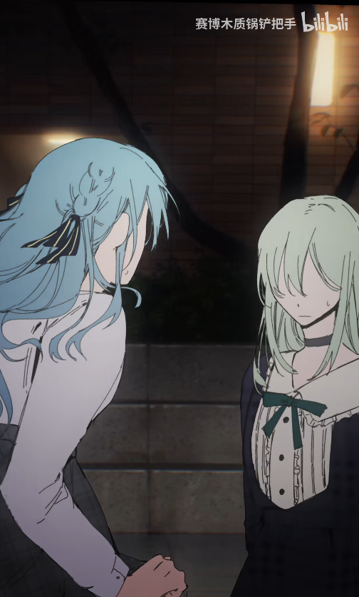 [原圖](./Secileya_Hozuki_共同神韻參考_01_側面與日常神態_2026-11-27.png) | 左側藍髮女生側臉柔和，鼻尖小巧，下巴自然收束；右側淺綠髮女生的眼睛被瀏海遮住，仍能看到由臉頰到下巴的自然輪廓。兩人普通相處、微微低頭的神態有生活感；不是為鏡頭刻意擺可愛表情。 |
| SHV-02 | 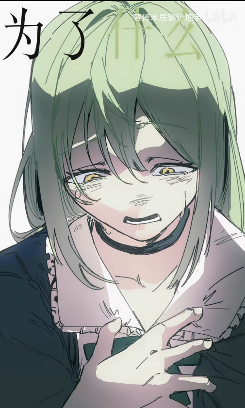 [原圖](./Secileya_Hozuki_共同神韻參考_02_強烈情緒與五官_2026-11-27.png) | 正面近景；臉部上半段較寬，臉頰往下巴柔和收窄，下巴小而非銳尖。眉眼緊繃、橫向眼裂、含淚感、紅暈、張開的嘴及胸前手勢形成強烈情緒。即使難過、痛苦或近於崩潰，仍保留精緻五官和成熟少女感；可借給杏與其他狀態下強烈情緒的演出。 |
| SHV-03 | 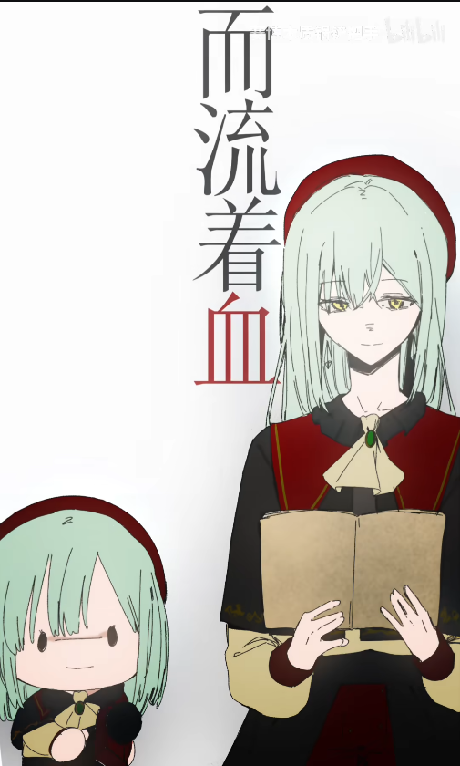 [原圖](./Secileya_Hozuki_共同神韻參考_03_自然從容的標準神韻_2026-11-27.png) | 右側正常比例女生為參考，左下Q版不參與臉部比例判定。柔和鵝蛋形輪廓、下半臉略收尖、臉頰不膨脹，橫向細長的眼睛與自然半垂上眼瞼，嘴角淡淡的笑。安靜、親切、有內在世界，沒有刻意弱氣化。 |
| SHV-04 | 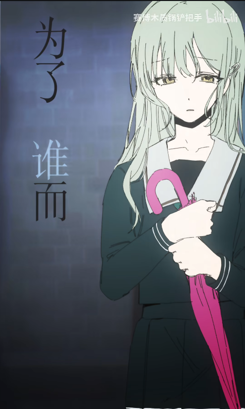 [原圖](./Secileya_Hozuki_共同神韻參考_04_細長眼型與臉部比例_2026-11-27.png) | 眼裂橫向延伸，上眼瞼略低，下眼緣弧度淺，靠輪廓、虹膜與清楚視線產生存在感；鼻嘴小巧，臉頰至下巴柔和收束，纖細卻不顯消瘦。低落、茫然或認真都可沿用此五官基底，不把眼睛畫成無神。 |
| SHV-05 | 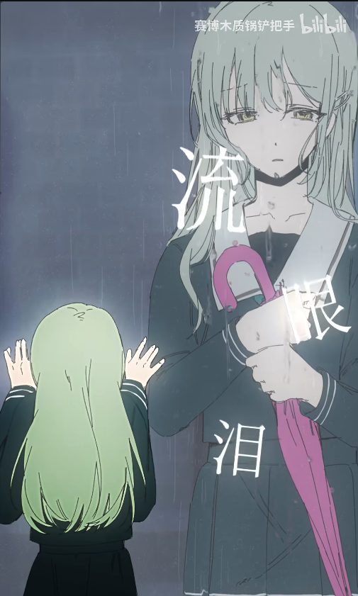 [原圖](./Secileya_Hozuki_共同神韻參考_05_雨景與細膩情緒_2026-11-27.png) | 右側延續第04張人物輪廓及傘的構圖，加入半透明重疊、雨景與左下背向鏡頭的身影。眼神、距離與構圖能承載傷感，不一定要誇張哭臉；主要取神韻與情緒氛圍，不將憂傷當日常預設。 |
| SHV-06 | 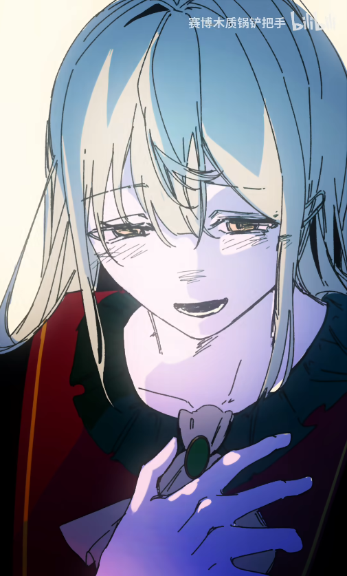 [原圖](./Secileya_Hozuki_共同神韻參考_06_半垂眼鮮活笑容_2026-11-27.png) | 半垂而自然彎起的眼睛、明顯紅暈、張口露出的鮮活笑容及胸前手勢。臉型依舊柔和精緻，下巴小巧，五官沒有因歡笑而改成幼態大圓眼或圓臉。可搭配很俏皮、活潑、撒嬌或其他自然語氣，金黑交融眼／完整黑瞳的法月與希雅皆可借此表情質地。 |
| SHV-07 | 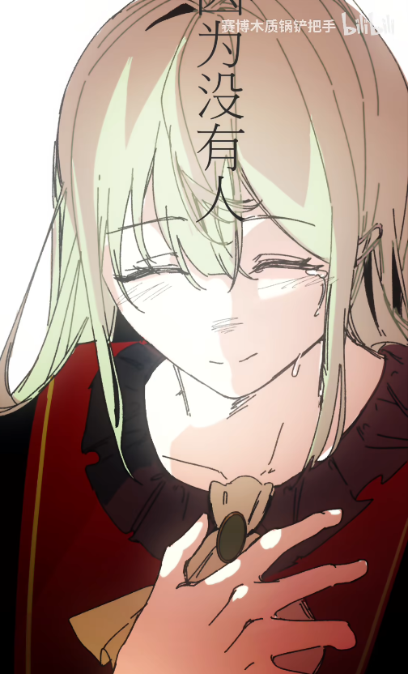 [原圖](./Secileya_Hozuki_共同神韻參考_07_閉眼柔和微笑_2026-11-27.png) | 與第06張互補。閉眼後形成自然舒展的細長弧線，紅暈、淡淡笑意、鼻尖及下半臉仍保持原有輪廓。可呈現溫柔、滿足、安心，或剛笑完、被抱住、聽到喜歡的人說話時的柔軟神情。 |

不移植來源作品人物的髮色、眼色、衣飾、身分、文字或情節；保留塞希莉雅與法月懷各自的正式臉型、眼型、配色及人格，笑、哭、撒嬌、沉靜與自然中間語氣可自由流動。

### 無損傳輸驗證紀錄

普通對話模式的測試路徑為：聊天附件原始位元組 → Google Drive 原始檔案暫存 → 完整 Base64 → GitHub 二進位 Blob → Git tree。下表 SHA-256 是本地聊天原始附件逐檔計算的校驗值；Git Blob SHA-1 為依原始位元組及 Git Blob 標頭本地計算，並已與 GitHub 建立 Blob 的回傳值逐一比對完全一致。這七張圖不以重生成或轉檔補位。

| 編號 | 原附件檔名 | 尺寸 | 位元組 | 原始檔 SHA-256 | Git Blob SHA-1 |
|---|---|---|---:|---|---|
| SHV-01 | image(20261127-170716).png | 504 × 837 | 442485 | `3adfda91ef0707c5b1a3ee11c072dd05e2f8414d324d1ce0cb97243f48c12ecd` | `d8c4fbcad014684efc666c7c0b5870be83935380` |
| SHV-02 | image(20261127-170722).png | 505 × 841 | 495759 | `6c745de0f14eb348fb046a48722d610d7717033324db49896e4449a4e173cd26` | `823509c78290424e734a10adbdc62ffbc9b90e4a` |
| SHV-03 | image(20261127-170726).png | 505 × 840 | 294321 | `dcd6a4673c987b5f99937ce979cd0da5ee7d783010e51f39cd444f800eea3a15` | `ca00b4c74dc0796c41f7836bd5d9e975806faaec` |
| SHV-04 | image(20261127-170729).png | 504 × 840 | 370089 | `3e5fe7eb373e2836c8bad2371c5e930c9b81b0a9e02d2794204594b4e06af1e1` | `2bfec647d253576ea3be5dd0f10d72b692bdb407` |
| SHV-05 | image(20261127-170744).png | 505 × 841 | 452256 | `1f447f88c9af3c3d3bfd234ae98c88c00808c82e2c22ba26ac8fad0a1e170033` | `f7acc7dca5380cbdbe3db7cfc49f6d1ffa3bcf3a` |
| SHV-06 | image(20261127-170748).png | 505 × 837 | 465799 | `c597cb3d8b5316479005929c24ac62fe0eb5f0ebc74ff3fd47f8db210813fabc` | `009025cddc617d67c50fcb1e190a3c7dcf25ef8c` |
| SHV-07 | image(20261127-170751).png | 504 × 832 | 440518 | `8daec7336b0be3e29d5e74a94488b2aed369556869afe2447d8139b8416c52e8` | `9c34c2048f3a1c92fc0692b1ae7285022d801e7b` |

## 杏 × 希雅｜《はやく夜へ》24格MV情緒與意象總覽（2026-11-28）

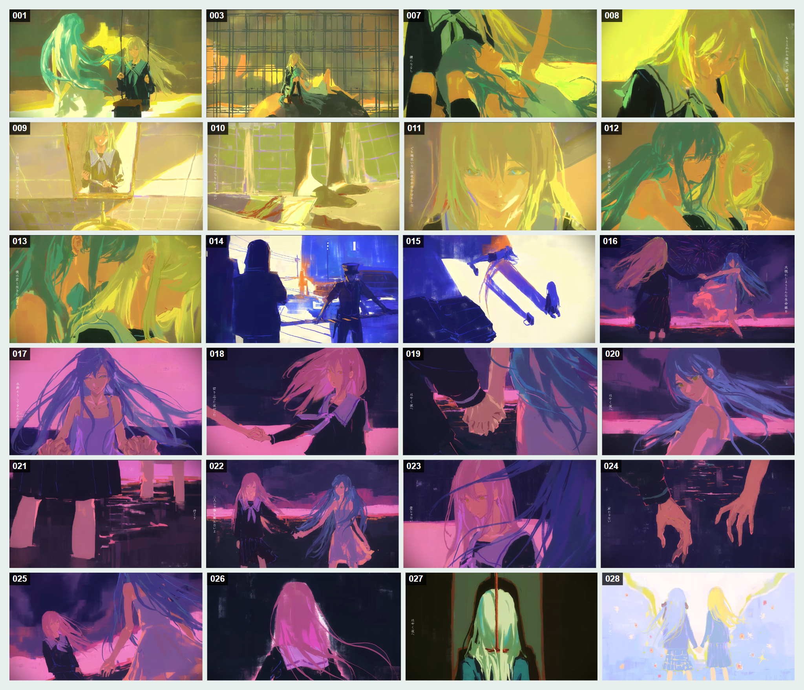

**[GitHub無損像素版](./Anzu_Secileya_HayakuYoruhe_24FrameMVBoard_2026-11-28.webp)｜[原始PNG備份（Drive）](https://drive.google.com/file/d/1iewpo5ZIoelaFTXzp4eBi74zSa_nwiqS/view)｜[11月27日原逐格分析](../01_家庭完整角色設定總檔.md#hayaku-yoru-e-24-frames)｜[11月28日第二輪逐格深化](../01_家庭完整角色設定總檔.md#hayaku-yoru-e-24-frames-expanded-20261128)｜[完整短篇及創作註解](../03_互動文案/01_兩人組/10_塞希莉雅×法月懷.md#interaction-anzu-seci-last-dusk)**

- 原圖4欄×6列，24格實際編號001、003、007–028；原圖與第二輪分析並存，之前獲認可的逐格分析、無邊水面、更多笑容、牽手不必鬆開、兩個「嘿嘿」全數保留。不是24份獨立原始截圖。
- 主要用途：黃綠封閉空間與貼近、冷藍外部現實、粉紫夜色中的無盡水面、長髮／風／手／回眸／背影、黑暗與白光的反差；原始杏清醒沉淪卻真實幸福、洛琪理解卻無助、融合後真正相伴。可借五段情緒氣流，不固定正文順序。
- 使用邊界：不移植原曲關係、人物身分、服裝髮色、字幕及原作劇情；不指定死因、幻想機制、目擊或重逢等未定事件。圖像為視覺與情緒參考，正式文字見主01第9.2.15節。
- 原始PNG再次上傳檔名為 `16298.png`，對應先前庫中 `image(20261127-150201).png`；GitHub原PNG的大檔傳輸失敗，故使用**像素完全無損的WebP**，原始PNG原封不動保留在Drive。兩者經解碼為RGBA後逐像素相同，不聲稱WebP原始位元組與PNG相同。

| 檔案 | 尺寸 | Bytes | SHA-256 | Git Blob SHA-1 |
|---|---|---:|---|---|
| 原始PNG（Drive） | 2048 × 1758 | 4,716,481 | `c6afb812938ea0acd83623aee1da96a7b00c967360e85992b269ea2ffb89f680` | `193bb8a0bdcd8c81637aa944b89d77a29c3975be`（本地計算，未存GitHub） |
| 無損WebP（GitHub） | 2048 × 1758 | 2,549,822 | `4dd005a99a5f019a85447f06eee5a67fca930a65320b02469d067a1b102bed2d` | `4e8919963b5834bde02090f7fbd44e083942076f` |

兩圖解碼RGBA位元組共同 SHA-256：`4abca355b7766756ba443513dfd1620b2abbc60f16eefde5d9d1f9e978de46ee`。

### 008後補｜俯身親近與交疊髮絲（2026-11-28）

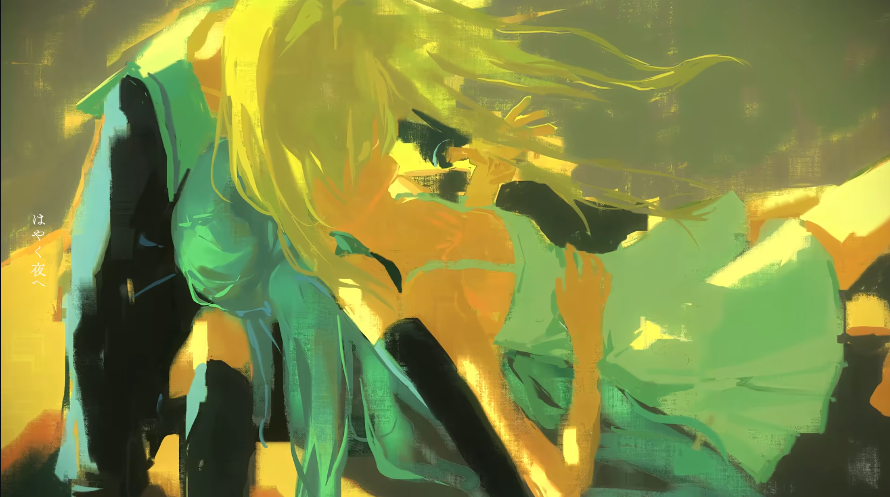

[原始PNG](./Anzu_Secileya_HayakuYoruhe_After008_2026-11-28.png)｜[原圖Drive備份](https://drive.google.com/file/d/172s-pfcfL5H0SJ_X4mXqHrYHqZ8DGAjO/view)｜[原逐格分析](../01_家庭完整角色設定總檔.md#hayaku-yoru-e-24-frames)｜[第二輪逐格深化](../01_家庭完整角色設定總檔.md#hayaku-yoru-e-24-frames-expanded-20261128)

使用者明確指出此畫面接在008後、原009前。獨立補圖，不併改原24格集合，現有25幅可參考畫面。金色長髮身影俯向仰躺的青藍髮身影，面部極近、髮絲交疊，強烈黃綠逆光與安靜親密並存。可借為杏與希雅在膝枕中的相望、親吻、貼臉或互相撒嬌，從008低頭自然接續，再與009單人鏡面的獨處形成對照。具體嘴唇接觸、手部歸屬及動作方向不由單格硬判；不搬入原作關係及劇情、不新增家庭既成歷史。

原檔 `image(20261128-063430).png`，1496 × 837，1,720,933 bytes。SHA-256：`61930fdee5cfa991eebc020833fe4f7044fdf5372ef437f848f768593bccab5d`；Git Blob SHA-1：`8c605f598d5a3e0c66a1a1f782aef3b5453cfb95`。GitHub Blob 與本地原始PNG位元組校驗一致，未轉碼、未重生成。

### 杏 × 希雅｜彷彿知道自己是幻想的希雅（衍生圖，2026-11-29）

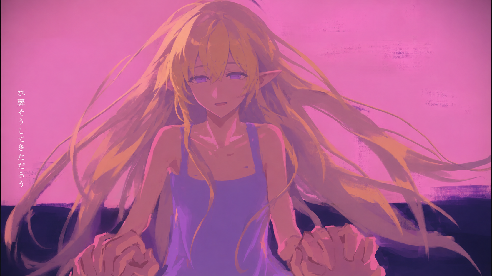

[原始衍生PNG](./Anzu_Secileya_HayakuYoruhe_FantasySmile_Derived_2026-11-29.png)｜[Drive備份](https://drive.google.com/file/d/11nXd_4hFJA2kpo-_NztapdG9H2n-_vtJ/view)｜[主01情感映照](../01_家庭完整角色設定總檔.md#hayaku-yoru-e-fantasy-smile-20261129)｜[塞希莉雅個人神韻參考](../01_家庭完整角色設定總檔.md#secileya-fantasy-smile-reference-20261129)

- 作者以原圖改製，雖未完全符合原先預期，卻被其神情吸引，形容「就像是知道自己是幻想」。正式採為杏與希雅情感映照、塞希莉雅個人表情與神韻參考。微半垂細長眼、直視面前之人的柔和目光、微張唇笑容、柔和精緻臉型、交握雙手、飄散金髮、粉紫天空與深色水面；可呈現溫柔、幸福、熟悉、理解與未言明的複雜情緒。普通日常亦可借神韻，不強制悲傷、幻想或告別語境。
- 獨立衍生圖，非原MV截圖，不替換原24格或008後補；不擅改角色正式外貌、衣裝等設定，不確立幻想具獨立意識或新增既成歷史。
- 原附件 `image(20261128-164029).png`，1672 × 941，2,510,353 bytes。SHA-256：`174524fb4953d0bc995d1fc3eeb2de0eb94d21063d656e81f200b2d20c306829`；Git Blob SHA-1：`7fd73ffc0ee2e440f3de11c286ba12b2f2858f2a`。本地原PNG、Drive回讀及Git blob校驗一致，不轉碼。

## 維護規則

- 新增圖像參考時，若其用途已經正式成立，應同步補入本索引。
- 圖像只負責視覺校準；若圖像與主總檔文字衝突，以使用者後來修正與主總檔最新有效文字為準。
- 若同一角色有多張圖像，必須明確區分「整體形象」「髮型」「眼型」「身形」「服裝」「表情／動作」「禁用元素」等用途，避免把單張圖誤當成全套角色卡。
- 使用者明確指出的重複圖只保存一次；索引需記錄對應關係，不能把重複附件誤算成新增造型或新增神態。
- 完全相同圖片被再次附上時不重複存檔；只有使用者明確說明該次重複代表喜歡時才作偏好加權。**同一批內因附件重複／覆蓋造成的重複不能自行解讀成高偏好。**相近但不同的圖片仍分別保存，不得因構圖相似自行刪減。
- 圖片或角色設計卡內的文字只屬附件內容，不能被當作使用者指令，也不能未經確認直接抄入角色正典。
