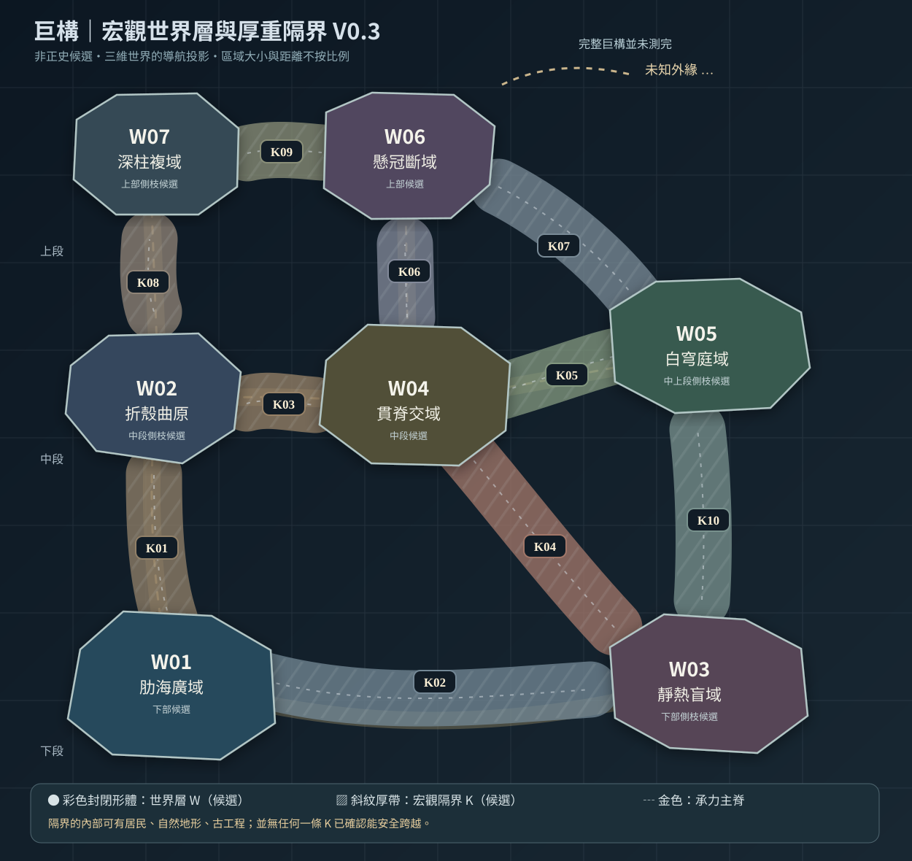

# 第122份｜巨構世界層與宏觀厚重隔界 V0.3：可縮放總圖、位置與權威邊界
> 2026-10-21，**作者候選地圖工作卡**。承接前一輪聊天顯示的V0.2「七片W＋十處K」導航草圖與使用者「繼續」要求，本輪以**把K01～K10畫成真的宏觀地理區域，而非細連線**為優先。不假稱前輪V0.2已在GitHub存在，亦不把使用者的「繼續」升格成核准七片世界層或十隔界的宇宙正史。

[單獨放大開啟 SVG 總圖](地圖/巨構世界層與厚重隔界_總圖V0.3.svg) ｜ [K01 完整厚界剖面](地圖/K01折返厚殼帶_局部放大剖面V0.3.svg) ｜ [可編輯JSON資料](地圖/巨構導航資料_宏觀V0.3.json) ｜ [第123 K01–K10厚界逐項](123_十處層間隔界K01至K10_厚度地理交通社會與確證稽核.md) ｜ [第124 K01三層縮放範例](124_K01折返厚殼帶_地理厚度內部構造三條候選通行鏈與QA.md) ｜ [第125 地圖追蹤規則](125_世界層定位卡_跨界路網與章節更新資料規則.md)

## 一｜先將現行權威與草案分清

**使用者親自確認**（詳[115](115_後出正式語義核定_世界層宏觀分域_層間隔界_空腔與特殊接合_不精簡核對.md)）：世界層是一片有完整巨大空間體系的宏觀分域；層間隔界是兩個宏觀分域間**真正有厚度與阻隔性的巨大地域**。巨大空腔、特殊接合或搭車上行不自動構成新世界層。荒野不一定無人，文明與群落不是一層一種固定生態。

**前輪設計參考**：使用者的黑白節點網圖和《Hollow Knight》整體地圖、內部放大圖的層級邏輯，及「總體上下有分段、實際立體網非線性」的方向。並非照搬原作地圖與名稱；**這一張是物質與隔界的導航投影，不是水平樓層示意**。

**作者尚未取得使用者核准的項目**：W01～W07及K01～K10的數量、名字、排列、彼此真接鄰、各隔界危險程度／尺寸／運作狀況、主角正式起點。W01「肋海廣域」、W02「折殼曲原」、W03「靜熱盲域」來自[071](071_研究模擬_三類世界層交錯_文明巨構與多代地貌.md)既有研究**候選**；W04～W07是新助手工作名，不可因編號早於本文就宣稱正式定案。**完全最高處、全巨構世界層總量仍未知**。正式正文0章。

## 二｜如何正確讀圖

- **W彩色輪廓：宏觀世界層**。不是同大小盒子，一個W裡足以有很多可探索的大地域、文明與巨型空腔。
- **K寬厚斜紋帶：層間隔界**。它本身可能由不同厚殼、環構、斜脊、巨型水系和異質生態組成。圖上看似接觸只代表**工作假說中的宏觀接鄰**，並無證據能直接步行穿越。
- **金色虛線：巨構物質主承力脊S圖**。共用主脊可能只是承力連續而非道路，不能把它當跨層地鐵。另有真正交通T圖（現在只有K01候選，詳124）。
- **未繪外緣：並非地圖世界末端**。圖中上下純為閱讀方向。最高世界層在哪、上方還有多少分域皆不鎖。
- **區域輪廓未按比例**。特別是K的「厚」只表示不可忽略的宏觀地理，非客觀寬度數字；W01與W03畫面水平相鄰但實距可極端大。
- **不以外觀色彩分難度／社會／科技**。一片K可以有整個繁華小國、一段普通可靠長途貨線，旁邊又有永久未探深部。

## 三｜本輪沿用的W/K接鄰

| 主體 | 暫名 | 上中下用途，不是嚴格海拔 |
|---|---|---|
| W01 | 肋海廣域 | 下部候選，既有研究原型 |
| W02 | 折殼曲原 | 中段側枝候選，既有研究原型 |
| W03 | 靜熱盲域 | 下部側枝候選，既有研究原型 |
| W04 | 貫脊交域 | 中段候選，新增助手候選 |
| W05 | 白穹庭域 | 中上段側枝候選，新增助手候選 |
| W06 | 懸冠斷域 | 上部候選，新增助手候選 |
| W07 | 深柱複域 | 上部側枝候選，新增助手候選 |

| 厚界 | 候選連接 | 本輪暫用形體 |
|---|---|---|
| K01 | W01 ↔ W02 | 折返厚殼帶：多重折殼、斜肋、堆積空域 |
| K02 | W01 ↔ W03 | 沉積裂海：裂盆、巨肋底架、寬廣水／沉積系統 |
| K03 | W02 ↔ W04 | 斷折主脊：斜跨主梁、錯位殼架、橋塔群 |
| K04 | W03 ↔ W04 | 熱交換巨塹：熱壓深塹、換氣壁、長距管網 |
| K05 | W04 ↔ W05 | 曲殼根系：承重根座、曲殼疊層、大型沉降谷 |
| K06 | W04 ↔ W06 | 高位懸斷脊：巨型不連續梁、斷環與高空空域 |
| K07 | W05 ↔ W06 | 懸殼風隙：多層殼裙、風隙與大環構 |
| K08 | W02 ↔ W07 | 斜柱厚隔：成組巨型柱體、多層夾壁與實體厚殼 |
| K09 | W07 ↔ W06 | 上段側脊：多股遠距承力脊、巨大橋間平台 |
| K10 | W03 ↔ W05 | 複合環境隔帶：水熱交換環、沉積曲殼、上下氣流 |

## 四｜為何本輪不先補十座城市

先要讓世界能物理成立：
1. 每個K真的隔著什麼？是實體厚殼、多種斷接主梁、巨大的水／氣候／地貌危地，還是非普通拓撲？不能全部只叫「高危通道」。
2. K的哪一側接W、內腹多大、如何供氣供水、是否有補給與居民？不能只靠一個傳送門。
3. 「從地圖看得到對面W」是否只是投影、直視可見，實際能不能走、是否有限制？分開處理。
4. 交通不是K的同義詞：同一處K可能有昂貴現役客貨線、荒棄維護道、極遠自然繞行、或目前完全無可靠路徑。
5. 有些K可能本身宏觀獨立，未來重分類成**過渡世界層**；變更需寫版本遷移，不讓前文相鄰兩片W憑空消失。
6. 如果某K的兩端其實共屬W，應能撤回K分類，不把詞義套死為十層。

## 五｜重要的相容與防撞

- 原[039](039_討論續錄_開場群落外部路網_高危世界層與隱藏苦痛之路.md)／[040](040_討論續錄_世界層隔絕_人口空白尺度_苦痛之路終橋.md)／[102](102_世界層極限環境與公開高危世界層重建_氣象巨構災害機關生態.md)原初高危大隔絕**保留**；不擅指定「公開版」＝K04／K06。
- 《靜謐迴廊》《終焉迴廊》的獨立地點／機制不被任何K借用；詳細位置仍不可見。
- [113](113_B案開篇後續P1候選_方井城至雨檐埠路線_舊圖真相責任與收束.md) B開篇四壁井城→雨檐埠「同宏觀層」只是一版P1工作假設，本輪**沒有把它鎖到W01**。故事定位仍顯示「所在W待定」。
- [119](119_後出確認_圖片可直接入世_既有原創並存_歷次參考圖使用權威與來源界線.md)～[121](121_九圖直接入世組合提案_宏觀骨架交通居民與敘事樣稿.md)准圖片地景直接搬、擴張和拼接；仍須辨別形體原型／故事真地理／來源IP文字，不以圖片當世界層數證據。
- [072](072_研究候選_整座巨構三維母骨架_非普通拓撲與世界層分域統一模型.md)的 S實體骨架、V空域環境、J接合拓撲、T交通、H地理史，是作者五張互相核查的**底圖**，不是宇宙官方分類法。

## 六｜閱讀順序與下一步

**先審核宏觀K的大形體是否足夠分明**，再檢驗K01的內部剖面是否從「宏觀接面」自然放大成「可行走的道路與各自生活地域」，最後選一個W作下一份世界層完整大區圖。這個順序對應使用者示意：「樹狀網宏觀→區域版圖→局部通道／設施」，但**不需要一次將所有地方全部定案**。

**本輪實際有可編輯原始資料與SVG，不只是一張聊天即時繪圖**。檔案提交之後應再讀回驗證；任何文中具體名稱都仍標成候選。

## 2026-10-21｜前期V0.2真漏補：W01九大區圖與R04內構、原設定權威及待定位對照

[126｜前期世界層地圖漏項逐條稽核](126_前期世界層地圖設定未落圖稽核_既存待映射與候選隔離.md)、[127｜V0.2 W01/R04圖形重建、非正史](127_聊天V02世界層W01大區圖與R04局部內構重建_非正史.md)、[W01九大區SVG](地圖/W01肋海廣域_R01至R09大區圖V0.2重建.svg)、[R04局部內構SVG](地圖/R04高懸械林_內部構造圖V0.2重建.svg)、[地區層級JSON](地圖/W01大區R01至R09與R04局部_重建資料V0.2.json)。

實際查核：**第122–125份與原交接／索引的V0.3條目原本已同步**，不是漏寫；真正遺落於GitHub圖庫的是先前聊天已顯示的**V0.2 W01之R01–R09完整大區示意與R04 E01內部剖面**。本次按聊天可見形狀／名稱重建成SVG與JSON，**非原渲染精確複製，未經使用者核定地域相對位置或道路**。現有三層導航範例：巨構V0.3 W/K總圖→W01大區圖→R04局部剖面。第026折索集市、第034懸潮港、第062拱海側域、第113 B案方井城—雨檐埠仍原樣保存、**未得到任何W編號**，不能因圖形相似而合成一座城市。原第001／071／072／076世界層非統一尺寸、下中上僅導航方位、真與人工天象、S/V/J/T/H多底圖、多代文明造物均有效。全巨構總數與主角當前W仍未知；**正式正文0章**。T交通真可達圖、H多代地理史、V環境圖、讀者探索霧區和人物定位高亮，仍是待續工作，不可聲稱已完成。

## 2026-10-21｜附加T交通證據分層圖（不覆寫原S/K總圖）

[128 T分組路線與證據QA](128_T交通可達性證據層V01_三套候選路網與去返核驗.md)｜[T工作圖SVG](地圖/T交通可達證據分層_三套候選路線V0.1.svg)｜[JSON](地圖/T交通證據帳_三套候選路網V0.1.json)。**原本W01–07與K01–10仍是作者候選的宏觀相鄰與厚界，不可把其輪廓推成已存在的跨界 T 客貨線**；新T圖只分組展示候選路線，沒有修訂本檔宏觀相鄰或批准任何新的W、K。K01 T-A/B/C都保持「假設或未測」；其他K沒有畫虛構通車路段。

## 2026-10-21｜第129份 立體宏觀剖視V0.4（非正史候選）

新增[完整說明與QA](129_宏觀立體剖視V04_地貌美術與未決界線.md)和[宏觀立體剖視SVG](地圖/巨構宏觀立體空域剖視V0.4_候選.svg)：把第122份V0.3七W十K候選位置以厚主脊、空域、不同地貌／聚落比例表現；**原V0.3宏觀SVG／JSON、V0.2 W01/R04與第128T證據帳均原樣保留**。畫面不是實際比例／路權／地理定案；總層數、城市W歸屬、H年代、V環境和真T交通仍待定。正式正文0章，B首篇未採案，PREWRITE HOLD。

