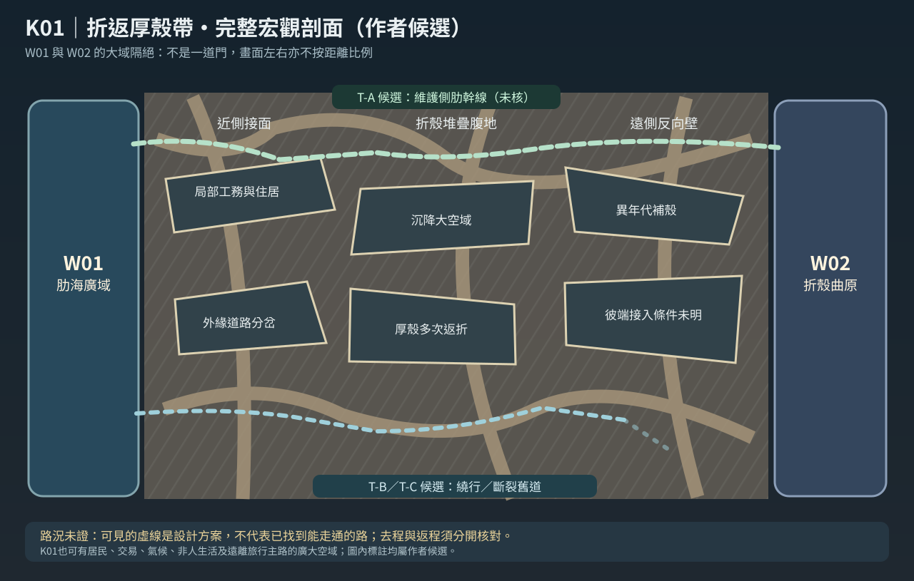

# 第124份｜K01「折返厚殼帶」放大設計：不是一道門，是三片大地貌和多種真路權

> 2026-10-21，非正史**作者層候選剖面**，不等於此界的最終線位／難度／住民。承接[122宏觀世界層地圖](122_宏觀世界層總圖V03_真正厚重隔界與非線性主脊.md)、[123厚界完整研究](123_十處層間隔界K01至K10_厚度地理交通社會與確證稽核.md)。使用者先前指出圖四是圖三「局部放大內部構造」，這裡按同樣的地圖結構**宏觀W/K→K01本地全圖→工務線及接面剖面**實際落地。

[單獨開啟剖面 SVG](地圖/K01折返厚殼帶_局部放大剖面V0.3.svg) ｜ [回巨構總圖](地圖/巨構世界層與厚重隔界_總圖V0.3.svg) ｜ [讀可編輯路線JSON](地圖/巨構導航資料_宏觀V0.3.json)

## 一｜兩端雖有W01與W02，K01腹地本身不是「過場」

K01假設從W01某段高肋外緣出發（**並非已核定對應第V0.2 R01高肋外緣的哪座站**），穿過大尺度**近側接面**，再進一片因多重承力折殼反覆回轉、其他年代居民與設施沿界面反覆擴建而形成的**折殼堆疊腹地**，最後在另一片遠側反向壁附近尋找通W02的真接口。

- **不能只靠視線判斷距離**：人可能在近壁看到反向巨殼的一塊明亮外觀，實際路卻必須先下降、繞外殼半周、再上行幾個工務系統。
- **不能把巨大折殼都寫成死牆**：殼間可以有寬廣平台、數百年沉積的土與植物、泵站、巨大維修井，甚至一片成熟長住社會。
- **不是三層房間**：三片「近側／腹地／遠側」只是導航跨度大區；每片自身還可有多片完整空域與不同年代路網。
- **不要把K01整片畫成同一種褐色鋼筋**：同個隔界裡可以有青色現役承力設施、灰褐古殼、自然河谷、暖燈居住區與無燈深部。
- **身份資訊差**：某些修路人熟悉某條梁、某個商行知道一段可靠貨道，旅人知道的可能只有售票點；不需要每個居民都知道整個K01的真實三維布局。

## 二｜地貌草案：一段跨宏觀尺度的區內序列

### K01-A「近側接面」—不是一扇巨大門

可以是巨肋逐步沒入多層折殼的**大前緣地域**：承力支座、修護區、零星聚落、外緣的廢鋼架林、物流節點和極多不同方向的小道。你可能看見沿壁數公里的燈火，也可能沿一座舊設備行走大半天仍未接近真正深部；這裡的體量**不是固定數公里，須用長距感及視線實際對比寫出**。

候選工作例：一名外來商人只需要W01端合法現役站台就能把貨交給K01近側居民，根本不打算跨到W02；另一個住在此處的家庭一輩子都未深入遠側反向壁。兩者不是未完成的「過關人」。

### K01-B「折殼堆疊腹地」—真正隔離感形成之處

巨殼像層層互相頂住的厚生物骨骼，而每一片殼面與另一片接面間，都可能藏著**可容納城、林地、工務廊、沉積坡或失去支承的斷路**。大型平臺的承載關係不是見門就開，可能要透過鄰側支柱分攤。某些區域人工管線仍在服務居民，另一些維修空腔多年已無人照看。

候選工作例：一道實際可靠的公用客貨線能跨其中一段，但舊圖又標了一條短近道，結果那條路早已因長期補殼改接而不能從這側返程。**只有等故事真正落地時，才能決定哪張路圖是真的；此處並非第113唐榆／游洵事件的既定原案**。

### K01-C「遠側反向壁」—看得到W02不等於已踏入W02

從某些視角可看見遠端大型丘陵或曲殼內的大片文明區，但中間仍有**最後一道厚殼接面、維修線、空域落差或法權限制**。旅人真正何時離開K01、進入W02，需要可靠的宏觀界線判準，不是過了一個城市大門就自然成功跨層。

本地人可對某座遠側檢修站完整熟悉，與從W01一路走來的人相比只是**情報不對稱**，不代表本地知識必然比主角低。

## 三｜三條「可能存在」的跨越路線，彼此有真成本差異

| 假說路線 | 局部可行構造 | 最重要的證據／門檻 | 去程與返程 | 目前狀態 |
|---|---|---|---|---|
| **T-A 側肋檢修／商運幹線** | 真工程梁體相接、有多站維護、可能包含大型載具與行人廊 | 需要確認連續承載、現役班次、合法使用、事故紀錄、接入W02末段 | **雙向只是假設**；班次／負載／壓差可造成不對稱 | 候選 |
| **T-B 外殼長距繞行** | 沿多重殼外側繞遠，經補給、荒野、民居與地方道路 | 路本身有沒有斷、補給間距、季風、實際方向、哪側能上／下 | 去程可能順風，返程或需另搭貨運；待核 | 候選 |
| **T-C 失修舊殼裂道** | 老殼夾縫／廢維修井、有人聲稱曾走過，遠處可見但沒有連續實勘 | 接口是不是被填死、失效工程是否真連到彼端、能否返程 | 完全未知 | **未測，不是秘密通關捷徑** |

**核心邊界**：當某個很強的人能用特別能力跨過某個段落時，不能反向推定T-A公共工程因此不存在或失去價值；也不能當作普通人沒有設備仍能跟著跨越。跨界權限、裝備、技術與生命型態須獨立記錄。

## 四｜K01放大：區域與內部構造不是同一張圖

1. **宏觀圖**：W01 ↔【K01巨型厚殼地帶】↔ W02，只表示接鄰假說，不表示有橋。
2. **K01全域圖**：K01-A近側、K01-B腹地、K01-C遠側，每區有自己的居地、厚殼、不同年代工務和路網；有時移動很久仍在同個K。
3. **內部構造剖面**：例如T-A某段的工務站：承梁真支承、上層維修橋、中層集貨平臺、下層沉積池、電梯實際停靠與不可走的維修門，才會像使用者圖四一樣能看結構。
4. **人物局部地圖**：若角色只在工務站停兩天，作者不需要把整片K01全部寫給讀者；但要知道角色站在哪個結構面、來路是否可回、朋友在哪裡工作。

## 五｜三段現場測試：直接看圖中的巨構如何成為有人生命的地方

### 測試甲：近側與出勤（非正史）

上午最後一班運殼料的車剛離站，工務平台上的人便開始往不同方向散去。有的回家，有的沿橫向承力梁去另一處修路。外來旅人站在護欄邊，望見無數層灰褐巨殼向斜上方折去，像一座看不出哪一部分算山的建築。

他問賣熱麵包的攤主：「上頭那條發亮的路能通到另外一邊？」

攤主抬頭，沒急著回答。他往遠處比了兩個方向。

「哪一邊？如果是修路隊走的那條，這星期只開夜班貨車。你看到更高的燈？那是另一座站，別從這裡算路。」

### 測試乙：腹地的自然（非正史）

兩層厚殼夾出的谷地寬得出奇。最外側是布滿管架的舊工務坡，往下卻已經長出小片濕林。真正引水的那條大導流壁不知哪個年代建起，表面分別是斑駁的工具刻痕與新綁上的排水繩。

幾名學生坐在坡邊畫植物。遠處一座載貨升降架緩緩經過，陰影掃過林冠，也掃過後方那條根本望不到盡頭的反向殼壁。

對他們而言這不叫「異常地區」，只是祖父母住了一輩子的地方。

### 測試丙：遠側看得到卻到不了（非正史）

遠處那片明亮的居地已經能清楚看見了。

從觀察窗望去，城市後方的巨大曲殼甚至有完整天空一樣的光色。旁邊卻沒有一扇通向那裡的門。唯一有燈的檢修橋在下方數層，最近的一座正常載人臺位於他們身後的路口。

「不能從這裡直接過去？」有人問。

工程師看了一眼兩個巨大殼面之間的黑影。

「可以看見，不代表兩邊承著的是同一片梁。」

## 六｜作者首次跨K01的地理驗證清單

- 確定W01到K01是經哪一塊宏觀承力接面，而非單純從小門進入；K01到W02的真界線另記。
- 三片K01大地域至少各有一套真實可描述的巨大環境，不能全靠同款灰樓。
- 若有T-A現役路，說清維護單位、終點、費用、普通人是否搭得到；如果沒路，也不要暗示已確認有。
- 角色使用的能力不抹掉普通道路的經濟與人口生命。
- 天氣與照明按照局部V圖，可能有人造照明、間接日照或真天象，不用一個世界層共用永久固定色溫。
- 返程與去程分開；最重要，**跨過K01不代表已朝宇宙最高處前進多少公里**。
- 確認K01沒有偷用《靜謐迴廊》單獨白橋、復歸獎勵或《終焉迴廊》單向越界的獨特規則。
- **在使用者正式核定前，本檔一切具體地名、交通、視角、工程連續性仍可修改**。

若日後發現K01實際大到具有獨立宏觀完整體系，須重新考慮「過渡世界層」分類；地圖資料可把它由K提升為W，不會因此刪去它以前已建立的居民歷史與道路。
