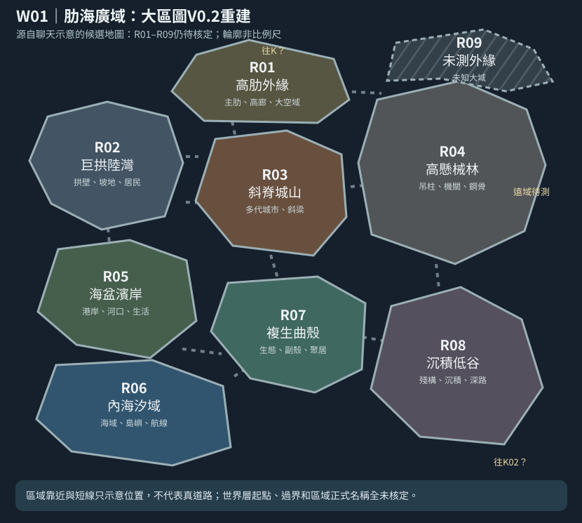
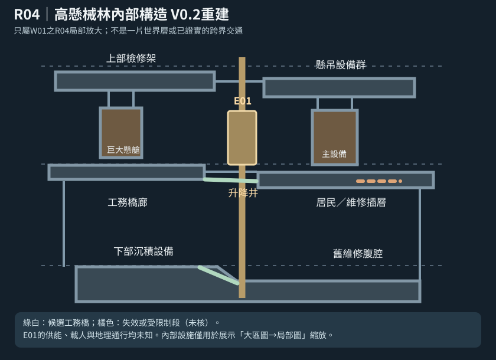

# 第127份｜聊天V0.2地圖補存：W01大區與R04局部內部構造（重建，非正史）

> 2026-10-21。此前聊天回答實際展示過兩張圖：**W01 R01–R09世界層大區**與**R04高懸械林局部內構E01剖面**。它們沒有獨立存於GitHub地圖資料夾。本次按那輪可見的輪廓、相對佈局和名稱重建為可打開的SVG，不是逐像素原圖備份，不將聊天設計草圖升格為用戶核定世界地理。

## 真正三級縮放鏈

1. [宏觀世界層 W/K 總圖 V0.3](地圖/巨構世界層與厚重隔界_總圖V0.3.svg)：看巨構主脊、W世界層、K厚重隔界、未知外緣。
2. [W01肋海廣域大區圖 V0.2 重建](地圖/W01肋海廣域_R01至R09大區圖V0.2重建.svg)：進入單片宏觀分域，見R01–R09九片大型候選地貌（不代表只有9片）。
3. [R04高懸械林局部內部構造 V0.2 重建](地圖/R04高懸械林_內部構造圖V0.2重建.svg)：從W01的R04放大，見懸橋、設備、工務架與局部E01升降井，不表示跨世界層。
4. [W01/R04 JSON 資料](地圖/W01大區R01至R09與R04局部_重建資料V0.2.json)：保留可更新的雙層地理關係，不取代V0.3宏觀JSON。

## R區原先候選圖形

| R | 地貌與放大目的 | 不得偷寫成已定的內容 |
|---|---|---|
| R01 高肋外緣 | 巨肋、高廊、大空域，可能接向遠方宏觀隔界 | 並非已核定K01唯一進口或有可靠跨層路 |
| R02 巨拱陸灣 | 大拱、坡地、可能居民生活與交通 | 不直接等於第001最初圖片巨拱或第026折索集市 |
| R03 斜脊城山 | 多代大城市與斜梁環境共存 | 不是第113 B案方井城的已確定位置 |
| R04 高懸械林 | 巨吊柱、工務網、機關與巨大鋼構，允許局部放大 | E01升降井能否運作、載人、繞路均未定 |
| R05 海盆濱岸 | 河口、沿海生活、物流、商港候選 | 不會因都靠海就直接等於第034懸潮港 |
| R06 內海汐域 | 一大片真的水域、航道與群島 | 不自動證明所有海灣其實同一片海 |
| R07 複生曲殼 | 自然綠地、生活副殼、植被與巨構混生 | 不取代第068／097原創自然地域 |
| R08 沉積低谷 | 沉積物、殘構、深支路或荒置腹腔 | 不代表完全無人、只有怪物或永久灰霧 |
| R09 未測外緣 | 未知區域和霧區，保留探索地理的缺口 | 不代表真正W01盡頭或整座巨構最終邊界 |

## R04局部概念圖的使用邊界

上部工務架、懸吊設備、地帶間維修橋、局部住居插層、底部沉積設備與E01只是**有可能成立的實體構造排列**。能見不能自動能達：需確定橋是否連續、承重、供能、誰維修、有無居民與他們的生活利益。若故事角色並未走到R04，讀者無須預先知道此圖全部構造；作者仍應在世界地理中保留這些可能性，而不是每章任意改路。

**W01不是主角正式所在地**。截至本輪正式小說仍0章，第110 B開篇只是比較受使用者喜歡的候選，第113方井城→雨檐埠的同世界層路段是假說，並未得到W01編號。要畫真角色定位點，應先有正式地點和時間證據。

## 不與前輪厚界總圖競爭

122～125＋V0.3總圖重點是**巨構主脊與K01–K10真正厚度**；本份補存的V0.2世界層內分域圖與R04工程局部圖是一個更深尺度，兩者並用。若未來修改W01的輪廓、R04的設備或宏觀隔界接面，須保留V0.2重建史，寫明新版地圖決策與原因，不能把示意版悄悄當真。

## 2026-10-21｜新增交通資料層的相容界線

第128份[可達證據層](128_T交通可達性證據層V01_三套候選路網與去返核驗.md)已將R04/E01標示「設施候選、運轉／載客／接通程度未知」，**沒有**從本份SVG反推出E01與R01、K01、B案E3/E5或任何W跨界站相通。本檔的R01–R09是候選地貌構圖而非T交通線路圖；第128的三組路線也不替此圖補出不存在的道路。

