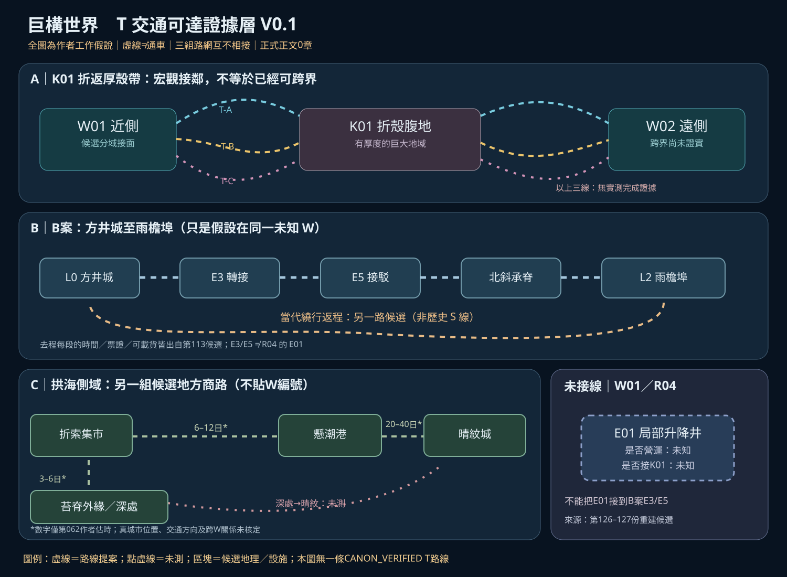

# 第128份｜T交通可達性證據層 V0.1：三套候選路網、方向、可返與地理歸屬（非正史）

> 日期：2026-10-21。接續[第126份未落圖稽核](126_前期世界層地圖設定未落圖稽核_既存待映射與候選隔離.md) A04、A08、A09、A17。這是**來源核對＋作者工作地圖**，不是使用者核定交通正典。正式正文 **0章**，B首章偏好但**未採案**，PREWRITE Gate **HOLD**。未進行實地調查／沒有新的角色事件，也不對整庫逐字全審作保證。

[SVG｜T交通證據分層圖](地圖/T交通可達證據分層_三套候選路線V0.1.svg) ｜ [JSON｜可追溯路段證據帳](地圖/T交通證據帳_三套候選路網V0.1.json) ｜ [第125｜定位與路段規則](125_世界層定位卡_跨界路網與章節更新資料規則.md) ｜ [第122｜W/K宏觀圖](122_宏觀世界層總圖V03_真正厚重隔界與非線性主脊.md)



## 0｜本輪讀源範圍與結論（避免過度宣稱）

- **核對來源**：第003交通、第026折索多出口、第034懸潮六出口、第039外部網、第062拱海四處商路、第071形體／可達／時間分圖、第072 S/V/J/T/H、第075立體人行／運具、第113 B案方井至雨檐埠、第122～127世界層與厚界／地圖資料；重要的後出語義仍以第115為準。
- **使用者已確認的原則**：世界有非線性的立體道路，常態客貨交通、危險野路和跨真正宏觀隔界的各式成本可並存；上行並非每次跨世界層；世界層＝完整宏觀分域，隔界＝真正大地域；荒野不必無人。這**沒有**直接確認任何本文具名 T 路線現役運轉。
- **真空白**：目前的 W01～07、K01～10、R01～09仍是可改的作者候選；真正可靠的跨界交通完整表**未建立**；主角所在W、全部世界層數、各路線實勘、現役班表、最終海拔、所有城市的W歸屬均未知。第126補了三級示例的圖資缺件，不等於補齊上述事實。

## 一｜從形體到真正完成通行，應至少分七層證據

| 階段 | 需要分辨的問題 | 不能替代的證據 |
|---|---|---|
| S / 結構關聯 | 一段承力梁、殼、鋼構是否物理同源／連續？ | **沒有**行人路與客貨承載的直接證明 |
| V / 目視關聯 | 人能否從此端看見彼端或看到一道亮光？ | **沒有**相連、可達或距離證明 |
| J / 接合關聯 | 特殊幾何連接是否真在此處起效？ | 仍未證明居民能經常穿行／可以攜貨 |
| T1 / 物理可走 | 對哪一類行人／生物／載具可連續到達？ | 要核實路面、段間接口、承重、供能、氣壓、生態 |
| T2 / 現役可用 | 此刻路線是否維護、開放、有班次或停靠？ | 要有近期工務、目擊、行車、事故與季候資料 |
| T3 / 具體人物合法可用 | 某人能否憑自己身分、能力、票證與裝備搭用？ | 通行權、費用、補給、貨重、時段；人能過不代表貨能過 |
| T4 / 完整去返及跨界 | 去程/返程是否各自可靠？真的通過K遠側接面到另一W嗎？ | 路程兩方向分別記錄，且有**宏觀隔界定位證據** |

此表是**作者核查階段**，不是世界內官方級別，也不是七道必做任務。某條路可以局部滿足T1卻沒有T2；某位高階者本人能通過不表示有普通客運；沿梁能行走不必然跨W。

## 二｜證據帳分三級：不要把地圖畫面視為事實

- **USER_RULE_CONFIRMED**：使用者已確認的世界規則（例如跨層不等於搭一次電梯、行人和貨運可達不同）；不是任何具名線路的運行證據。
- **SOURCE_PROPOSED**：第062／113／124等明確標成助手候選的具體道路、旅時和地方利益；可供模擬，不能聲稱有人真的走過。
- **UNSURVEYED / UNKNOWN**：舊殼裂道、R04 E01的運轉、W編號歸屬、真正K遠側完成跨越等，記為 **null**／未測；不是假設其不可通，也不是默認可通。

路段status 使用 **PROPOSED、UNSURVEYED、OBSERVED_LOCAL、DOCUMENTED_OPS、CANON_VERIFIED**。後三類**在本輪具體T路段一條也沒有**；不得以場景樣稿「看到人在坐電梯」冒充世界正史的班表。

## 三｜路網 A：K01 折返厚殼帶（W01 ↔ W02）／僅宏觀候選

[第123份K01](123_十處層間隔界K01至K10_厚度地理交通社會與確證稽核.md)和[第124份剖面](124_K01折返厚殼帶_地理厚度內部構造三條候選通行鏈與QA.md)區分**近側接面→折殼腹地→遠側反向壁**。W01/W02在V0.3圖面「候選宏觀相鄰」，不等於真已存在跨界交通。

| 路線 | 候選通達方式 | 去/返不對稱與待證 | 當前 |
|---|---|---|---|
| K01 T-A 檢修／商運側肋線 | 若承梁、維護站、供能與入口相連，可容工班與條件式客貨 | **雙向只是提議**；查班次、兩端接面、路權、承重和事故 | PROPOSED；兩側都未實勘 |
| K01 T-B 外殼長距繞線 | 外側環殼、民居、補給點、可能受天候影響 | 去程順風／返程需繞貨路僅假說；先確認每一段物理連續 | PROPOSED；去返未知 |
| K01 T-C 舊殼裂道 | 古井／斷壁與遠處可見舊接面 | 路究竟通不通、是否填死、是否能返都未知 | UNSURVEYED |

**不納入本輪T圖的**其餘K02～K10：第122/123有**宏觀形體與不同通道類型提案**，但沒有現役完整路徑證據。尤其K05「可以存在穩定商路」、K09「可能主要難在遠距」都不能改成「已有固定車班」。K01不代表其他K的通用通關制。

## 四｜路網 B：B案方井城 L0 → E3 → E5 → 北斜承脊 → 雨檐埠 L2（**世界層編號null**）

取自[第110非正史B案](110_非正史開篇對照B_從上面下來的人_真初遇連續試演.md)與[第113 B案P1](113_B案開篇後續P1候選_方井城至雨檐埠路線_舊圖真相責任與收束.md)。**整條是單一宏觀世界層內的遠行假設**，不是已確定W01的一部分。

| 段 | 第113候選運具／實際限制 | 原稿工作旅時，不是正式數據 | 返程 |
|---|---|---|---|
| L0市集→E3 | 公共升降／接駁，票／工務月票；驗班次與工區封鎖 | 30–60分鐘 | 原路可回？需核實 |
| E3→E5 | 轉接廊＋步行／搬運車；舊資料方向可能誤置 | 2–4小時 | 不能從去程推原路可返 |
| E5→北斜承脊 | 工務、貨運／拼載；確認橋臺承載、風口與契約 | 約半日 | 待核 |
| 承脊→L2雨檐埠 | 多補給、夜宿、居民商運，非沒有社會的單路副本 | 1–3日 | 需另查 |
| L2→L0備用返回 | 另一條有站點的貨運幹線繞行 | 2–4日 | **此路本身也是工作假設** |

**最重要的時間差／證據差**：第113假定唐榆當年的 **E去、S回** 是歷史測圖；後來資料彙整把分向註記漏掉，另一層問題是如今某段 **S接駁真可能改道**。此外P1作者又設想L2→L0**當代替代長路**。這三者不是同一張路、同一年代、同一級證據。艾莉維亞在候選故事中最多能用當天局部測量修正E3/E5相對接合，不能據此證明當年唐榆走法、如今S整段安全、最終返回或下一W已抵達。

諾亞未預先正式報名游洵隊也是第113候選，不可用圖把人物決策倒灌為既發生正文。L0/E3/E5**不是**第127 W01 R04的E01；後者只是另一套尚未定位的升降設施示意。

## 五｜路網 C：第062拱海側域的地方、長距與野路（與B案、K01不連線）

[第062原文](062_候選實作_拱海側域四處地景_交通人物與地方事件.md)給出一個**區域廊道候選**，不等於完整國境、單一宏觀W或經W01 R區定位。這些路線的6–12日、20–40日等數字，全部只屬第062的工作估時。

| 範例行程 | 作者候選交通 | 核驗重點 |
|---|---|---|
| 折索集市 ↔ 懸潮港 | 貨索／鐵路→轉運站→海盆商船；工作約6–12日 | 中轉站、真岸接面、去返班次與貨流；港口不是隔壁門 |
| 懸潮港 ↔ 晴紋城 | 遠洋商船與中繼港轉乘軌道；約20–40日 | 需正常遠程運輸與路權，不能畫成步行捷徑 |
| 折索集市 ↔ 苔脊外緣 | 勘路貨車至最後測站；約3–6日，深處另需長行 | 外圍有工務與採集，不等於全域無人 |
| 苔脊深處 → 晴紋方向 | 遠端舊測線僅暗示可能連接 | **UNSURVEYED**：不是已存在旅客捷徑，也不知道是否跨W |

折索集市（第026）、懸潮港（第034）、拱海側域（第062）、B案四壁井城（第113）都保存各自的**候選來源**。不因幾處同時有鋼架、上行與海灣而把它們指定成同一城、同一W或一日可走遍。

## 六｜未落定的局部 R04/E01、其他K與特殊場所

- [第127 W01→R04/E01重建](127_聊天V02世界層W01大區圖與R04局部內構重建_非正史.md)只有「上檢修架／工務橋／維修居住插層／升降井／沉積設備」的**局部可能構造**。E01是否通電、能否載人、連往R01或K01均**未知**，故本圖獨立畫成未接線卡。
- 《靜謐迴廊》《終焉迴廊》與 Celeste 公開高危地域均不定位到K01等一般厚界。《終焉迴廊》對一般越界者**無法循原單向機關返回**是既有獨立硬規則，但**目前不能把它畫成W07→最高處的已知交通線**；Celeste確定自由往返。
- W07不等於全世界最高W；畫面上的「上」不是客觀高度／距離公式。R04/E01設施與B案E3/E5**標號類似不等於同一座**。

## 七｜可填寫的T路段證據格式（每次新章／改圖需更新）

```yaml
id: "例：K01-T-A"
source: "來源文檔與具體位置"
status: PROPOSED            # 不得用作者設想冒充CANON_VERIFIED
from: "K01近側候選"
to: "K01遠側候選"
world_from: "W01 (candidate)"
world_to: "W02 (candidate)"
physical_continuity: null
passenger_continuity: null
freight_continuity: null
service_operating: null
direction_outbound: null
direction_return: null
who_can_use: null
permit: null
fare: null
estimated_duration: null
survey_date: null
survey_by: null
world_crossing_verified: false
knowledge_provenance: "第124作者候選，非世界內角色實測"
notes: "不知道就保持null；同一來源的推演與事實不混合"
```

### 升級 Gate（具名路段從 PROPOSED → CANON_VERIFIED 之前）
1. 這段是不是被使用者明確核定／正式正文實際寫出，而不只是助手方案？
2. 去程與返程分別連接哪些實體端點、適用什麼人物與運具？可驗證時間與路權？
3. 是否有可信的本地記錄、當下觀測與維護狀態；不同年代圖是否混用？
4. 跨越的是本W內的大域，進K腹地，還是**真正穿過K遠側接面到另一W**？
5. 這段道路是否與已有城市、商路、K草案、V/H層及人物知情範圍衝突？沒有證據不填數字或箭頭。

## 八｜壓力測試：繪圖不應代替故事因果

| 問題 | 正確暫答 | 還缺什麼 |
|---|---|---|
| W01與W02在V0.3碰到，普通人今天可搭車嗎？ | **未知** | K01全線連續、實際營運、票證與兩端接面 |
| 看到W01的R04高懸械林E01就能到K01嗎？ | **未知** | 從E01往K01實際各段連接與運營 |
| 諾亞開局就在W01嗎？ | **沒有證據** | 首章地點正式確立與W歸屬 |
| B案E3去程查過，E3原路返一定可用？ | **不能推定** | 歷史S線／如今改接與今日實測 |
| 折索到懸潮有候選6–12日，代表兩者正式位於同W？ | **不能推定** | 兩地真正宏觀分域歸屬 |
| 艾莉維亞個人能越段，貨運社會便不重要？ | **不能推定** | 不同運具、身份和費用的分離記錄 |
| 《終焉迴廊》是K01的第四條路嗎？ | **不是這份圖可支持的事** | 獨立場地真實位置／規則，不能套K |

## 九｜接下來的真缺口（與已交付成果分開）

**這輪已完成**：三組來源分離的T交通工作圖、JSON逐段證據欄與去返核驗；把第126「A04缺獨立T圖」推進到**T候選／證據帳可編輯**的程度。

**尚未完成**：真實跨K交通和營運證明、全部地區對應W、H多代建造／改線史獨立時間地圖、V環境與光照、探索霧與角色實際位置、人口分布和真正交通網全域測繪。**不得宣稱T可達圖「已證實」「整座巨構交通已完成」或第110 B是第一章。**

下一步可先針對**一條路線做實證條件壓力測試**，例如K01 T-A：先確認W01端、厚界內營運站與W02遠側接面的物理連續、去返營運、工班／商旅路權、環境與維護年代；或先為第113 B線定真世界層歸屬**之前**檢核其同層假說是否自洽。任何具名地名仍需使用者核定才可晉級。
