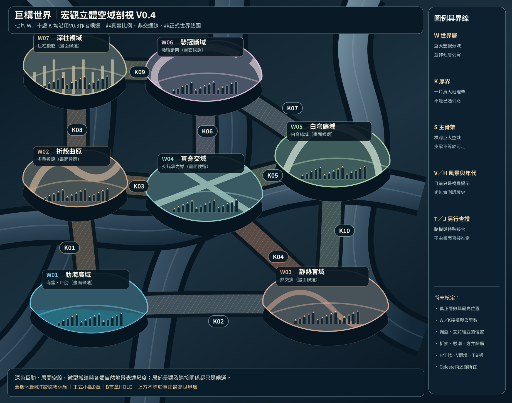

# 第129份｜宏觀立體剖視V0.4：讓巨構不只是一張七片色塊的平面圖

> 2026-10-21，接續第128份交通路網證據工作。這是**新增的可編輯SVG作者視覺候選**，不代表使用者批准W01–W07、K01–K10、它們的真位置和層數，也不是正式正文章節。B開篇仍未正式採案、PREWRITE Gate HOLD、正式小說0章。

[開啟立體SVG](地圖/巨構宏觀立體空域剖視V0.4_候選.svg)｜[原V0.3宏觀SVG](地圖/巨構世界層與厚重隔界_總圖V0.3.svg)｜[V0.3結構化JSON](地圖/巨構導航資料_宏觀V0.3.json)｜[第128交通證據圖](地圖/T交通可達證據分層_三套候選路線V0.1.svg)

## 一、這次做出的具體區別

**物質主脊／S**：多條粗大的承力骨架貫穿畫面，呈現厚重結構與空腔嵌套，而不只是「分域甲—線—分域乙」。畫出來的具體支柱和曲線只是立體視覺試案，沒有新施工史證據。

**宏觀分域／W**：沿舊V0.3暫名展示海盆巨肋、折返曲殼、熱交換、交錯骨架、白穹綠地、懸浮斷環、複層巨柱；每片W內的景觀只是某種可視意象，不是整個W唯一地貌／社會，也沒有將既有圖片的某張直接定成固定座標。

**宏觀隔界／K**：十條寬厚斜紋區域沿用V0.3候選關係。K可以包含居住地、工程、野地或真正無人段；其寬度像素不是實際公里，也沒有任何一條被證明現役客貨可通。

**城市與生態尺度**：圖上小建築、微光、水面與樹木都只用來對比空間量級，絕不從藝術圖推導居民數量、修建年代或政府歸屬。

## 二、與原檔的精確關係

本輪未改第122–125的W/K基礎圖與JSON；沒有改第126–127補回的W01→R01–R09→R04/E01三級縮放；第128的T路線證據帳也完全獨立且仍沒有已驗證跨K路線。圖中遠望、骨架實體相連、表面看起來靠近，都不能取代實際可達性、方向、返程與路權核查。

權威仍以第001、003、071–072、076、115、119–123、125–128的後修為準：世界層是宏觀完整分域、隔界是真大阻隔、可有正常客貨交通與極高危野路、有人世界與荒野共存；風景素材准許直接吸收與擴展，但具體世界地理位置須另行核定。

## 三、尚未完成與後續方向

- 真實世界層總數／世界最高位置／外部實際三維物質外殼，未定。
- 第062折索、懸潮、晴紋與第113 B案方井城、雨檐埠的真實W編號，未定。
- 第128交通證據層不因新增圖而升級為可通行路網。
- H多代建造史、V環境與光照地圖、J真特殊接合的位置，未定。
- 《靜謐迴廊》《終焉迴廊》仍按各自獨立規則，圖上不替它們定新位置。
- 下一步若這種立體景深符合要求，可挑K01或W01一片大區做更清晰的剖面縮放，再把實際交通、歷代建造與居民生活分層補進去。

**成果限於一張可編輯的V0.4候選SVG與完整說明。** 它是觀看巨大空間的升級，不是把猜想升格為世界正史。

## 2026-10-21｜第130份：V0.5主升程標註地圖（非正史）

[130完整主升程功能分層與QA](130_V05主升程功能分層_真正最高層目標與起點以下深構.md)｜[縱向原創SVG主圖](地圖/巨構主升程地圖V0.5_頂端目標與下方深構_非正史.svg)｜[V0.5 JSON](地圖/巨構主升程功能分層V0.5_非正史.json)。依使用者最近提供《空洞騎士》及《絲之歌》地圖參考，**把①起始底層聚落、②中央主升程、③真正最高世界層目標、④起點以下深層、⑤橫向多分支直接標在SVG**；P−1～P6是閱讀帶而非新的W，無真交通保證。查第001／026／028／044／048–050／053／069／115／125／128後維持：真最高層原本就是雙主角目標，不是普通王層或Celeste固定宮殿；越高不必越先進，深處不必無人；終焉／靜謐迴廊不強制成必經交通；原V0.3、V0.4、W01/R04與T圖不覆寫。B未採案、正式0章、PREWRITE HOLD。具體起點城市、所有P對W/K、頂端形制和去返道路均未核定。
