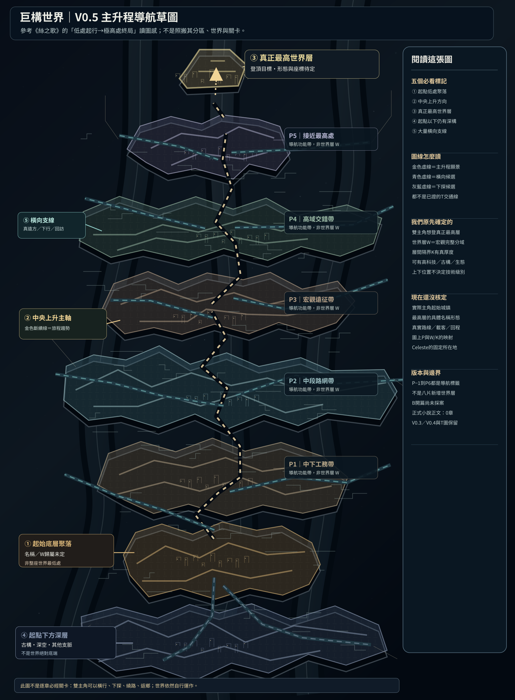

# 第130份｜V0.5 主升程功能分層地圖：真正最高層、低處起點與其下仍有深構（作者候選）

> 2026-10-21。使用者再次提供《空洞騎士》與《絲之歌》地圖，指出目前V0.4尚缺「由低處往真正最高處逐步攀升的視覺方向」，並特別要求起點下方**還有其他結構**，兩側支脈則要保留。使用者接著同意「可以改、可以優化、但不要無視以前設定」，並提供要在地圖上**直接標出**的五項清單。此稿為這項需求的第一張完整可編輯原創主升程視覺候選，**不核定世界層W／隔界K新位置，也不使B開篇自動成正式第一章**。正式正文0章、PREWRITE仍HOLD。

[獨立開啟V0.5 SVG](地圖/巨構主升程地圖V0.5_頂端目標與下方深構_非正史.svg)｜[V0.5機讀標記與功能分層JSON](地圖/巨構主升程功能分層V0.5_非正史.json)｜[V0.4立體宏觀圖](地圖/巨構宏觀立體空域剖視V0.4_候選.svg)｜[V0.3宏觀W/K圖](地圖/巨構世界層與厚重隔界_總圖V0.3.svg)｜[第128交通T證據圖](地圖/T交通可達證據分層_三套候選路線V0.1.svg)

## 一、圖面直接可見的五項標註（必須畫在圖中而非藏在文字）

1. **① 起始底層聚落**：P0，低處的人類／異族社會活動節點；**「故事的低處起點」不等於宇宙的真絕對最低點**。具體城市名稱與W歸屬未定，不能擅自寫折索集市、四壁井城或骸底鎮已採用。
2. **② 中央上升主軸**：使用金色分段虛線，自P0逐段指向P6，強調「經過廣大不同地區，一直想向真正最高處去」的冒險方向。**不是一根可從底坐到頂的真電梯**；未建立去返路權的線段不能當已通T客運，也不保證所有段已經有連續物理接面。
3. **③ 最上方終局目標**：P6，按第028／053既有用戶明確設定，應為**真正最高世界層**而非某一普通「王層」。**已定的是「最高層是雙主角原本就有的目標」**；目前尚未確定形制、實際地理座標、名稱、具體進入機制，甚至如何用地圖證明它真是最高。圖上的視覺最頂只表示敘事錨點，不是物理測繪與Celeste的固定居所。原先聊天「冠頂聖所」等詞僅是助手功能名，不升格為正史。
4. **④ 起點下方仍有深層遺構**：P−1，這是可展開的真正大片深層方向，不是起點腳下只有一格裝飾黑洞。可延伸另一些城市、舊梁、巨大深空、地下水脈、局部完整深淵與其獨有詛咒等，但**每一件具體配置仍可調**。保留第044墜落者與下方群落各種生活文化的可能性；下方可有人，也可真正荒涼，更深處甚至再接其他宏觀世界層。
5. **⑤ 橫向支線擴展**：藍綠虛線與多片不規則大地域，讓上升中的任何時期仍能橫行、下探、返鄉、繞大遠路、接商路或完全與主角無關地流動。左右支脈不代表走一分鐘能到，也不表示整張圖只剩眼前八區；現實的路程、載具、權限、地區活動和返程仍以未來T交通資料查核。

## 二、P−1／P0至P6功能帶：不是「八個正式世界層」

| 圖示功能帶 | 長篇閱讀作用 | 可能的社會、環境與活動（候選，不綁固定W） | 不可誤判 |
|---|---|---|---|
| **P−1 起點以下深構** | 世界深度、下行旅程、後期回探、與上方可能互不知情的生命 | 多代殼腹、深處支脈、殘舊工程、下方居民、自然生態，局部完整深淵可另設 | **不是世界最低世界層**；不能全區默認無人 |
| **P0 起始聚落** | 讓主角與讀者先看見有生活的巨構，形成長期登頂夢想 | 正常住屋、交易、維修、吊橋、正常客貨；可以有先進設備、怪異生物與不同族群 | 起點名稱未定，不能以低處＝最落後最窮 |
| **P1 中下工務帶** | 本地走向超大環境的第一批視野與地理後果 | 鋼林、泵站、人工海盆、住居工務、舊橋，新造通路與真正無人處都存在 | 不等於第一個K；升一座梯不等於跨一個W |
| **P2 中段路網帶** | 多出口商運、支線、自主旅行與回訪，讓選路有代價 | 各地域轉運、生態枝道、地方城邦、遠征市場、普通生活事件 | 不是必有統一中央管理局 |
| **P3 宏觀遠征帶** | 向上旅程首次明顯遭遇「宏觀地理難以輕易越過」的重量 | 大斷脊、超長繞路、厚界腹地、古代/現役跨域工程、甚至真正多月無人區 | **不能把P3直接等同K01或任何固定K**；也不預設每次都致命 |
| **P4 高域交錯帶** | 真正感到視野、技術與文明差異；仍不停止橫向探索 | 活躍高科技、清潔研究設施、古老厚城、野地與高等生態、複層社會 | 使用者允許真上層黑科技，**但不等於越高科技越先進的公式** |
| **P5 高處接近帶** | 最終高度的路線證據與選擇需要變得非常有重量 | 歷史失接、技術高門檻、昂貴但正常的客運或無法證明有路的斷面等，等待後續設計 | 不等於必經《終焉迴廊》、靜謐或固定祭殿 |
| **P6 真正最高層目標** | 主角本來就想抵達的真正最高層；登頂之後人生仍可繼續 | 具體地形、文明與進入機制保持未知，不能按《絲之歌》神殿直接複製 | **不是已核定「冠頂聖所」；Celeste不是固定待在頂上** |

**P是這張草圖的「主升程閱讀帶」，不屬於世界觀既定的W分域編號，亦非硬切的八個海拔平面。** 一段P可能始終在同W跨數個巨大地域，也可能涉及穿越K、在另一W蜿蜒繞行；反過來單片W內可以存在數段P。沒有證據時，P→W/K的對應一律保留空白。

## 三、與現行設定無損核對（必讀）

- **第001、第115**：世界層是有完整巨大空間體系的宏觀分域，層間隔界具有真正巨大地理厚度；大井／城市／特殊接合不自動等於一個新W。
- **第026、028、053、069**：Silksong的由下向上願景＋Hollow Knight多出口／技能回訪需並存；**真正最高世界層原本就是諾亞與艾莉維亞的長期目標**，模組與對手可成主線，但人物也有自由人生，登頂不是一切終止；不可用普通高處王層冒充最高。
- **第003、039–040、071–072、075–076**：大距離、真正厚界、連通／目視／通行／返程不同，世界可有一般穩定交通、高危野路與非普通J特殊接合；同一高度可以高低技術文明並存，真天象與人工天幕也不要求只屬某P。
- **第044、048**：豎向深淵可以有樓梯、下方居民與各種墜落原因／物質社會；單座深淵可有自己的特殊方向性詛咒，其底端再連另一巨大W；**不能給全巨構任何上升路線統一詛咒**。
- **第049–050、第058**：《終焉迴廊》是獨立已正式命名、一般通行者完成越界後無法循同一機關折返的特殊場所，方向偏上但出口未定；《靜謐迴廊》是另一處隱藏高難地形場所。兩者規則不混同，**都不硬塞成P5→P6的必經線**。Celeste確定可自由穿越她的機關且不必住頂端，早中期不主動對雙主角揭露真管理者身份。
- **第112–114**：B首章較受偏好但未正式採用；L0四壁井城→E3／E5→雨檐埠只是一套同W作者路程試驗，不能把它當P0正式據點，也不能把B路的E3/E5當W01 R04的E01。第114已採〈第三個座位〉是未來獨立場景，不因地圖推到高處或第一章。
- **第122～129**：七W／十K總圖、三層縮放W01大區／R04局部、交通T證據圖V0.1及V0.4立體剖視均原樣保存。**本圖新增的是主線向上的「敘事導航視圖」而非取代W/K物理地圖**。第128目前沒有任何正式驗明可跨K的具體路線；V0.5的虛線絕不能視作通車證明。

## 四、地圖後續怎麼逐步變成真正可用

**目前可做的是讀圖和審方向**：一眼看見最高目標、低處起點與下方更深空間，並可沿多方向分岔。下一步要先由使用者評估這種上升感，然後挑選要正式安放的第一個聚落和遠征片段，逐段檢驗其物理接面、正常載具、往返、工務年代、居民日常及角色知情；再和已存在W/K總圖建立有來源的連結。沒有使用者核定便不固定名字、P帶數量、任一城市到頂的真距離或中途必經的任一特殊場所。

**本份直接交付：** V0.5原創縱向 SVG（直接標①至⑤與P−1～P6）＋機讀JSON／功能帶核對＋本檔完整設計與權威界線。不是最終實際巨構3D模型，也不是準備發表的正式正典地圖。
