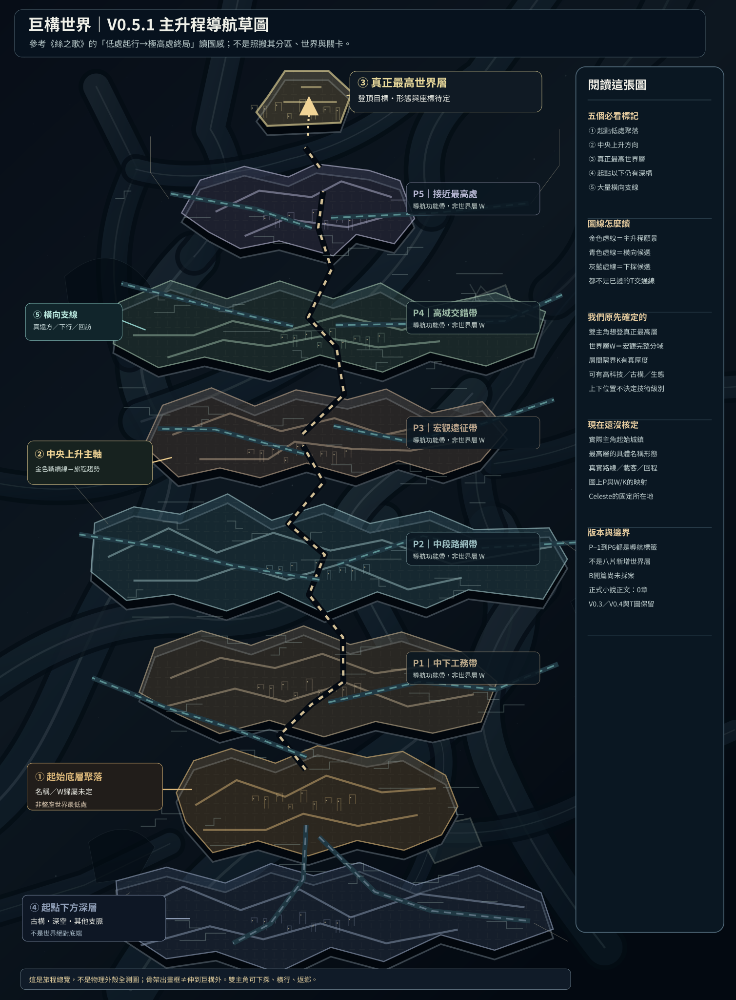

# 第131份｜V0.5.1主升程骨架改良：總覽與最外殼不能混淆

> 2026-10-21。使用者看到V0.5左右兩條過度平行的灰色大柱後指出：既有巨構為非對稱、不規則、多方向交錯、廣大空腔與多代建造；**已同意**改成斜向穿越多域、遠方轉折、局部後世包覆、部分超出畫面。使用者同時問：「這不是最外層的地圖嗎，怎麼還暗示外面有結構？那些結構有沒有其他功能？還是指被貫穿的世界層？」本份同時回答三件事。**不是新Canon地形定案，不覆寫130 V0.5或原W/K地圖**。

[可編輯SVG](地圖/巨構主升程骨架修正版V0.5.1_非對稱多代交錯_非正史.svg)｜[V0.5.1機讀稽核規格](地圖/巨構主升程骨架修正版V0.5.1_候選規格.json)｜[第130原版主升程](130_V05主升程功能分層_真正最高層目標與起點以下深構.md)｜[第072三維母骨架研究](072_研究候選_整座巨構三維母骨架_非普通拓撲與世界層分域統一模型.md)｜[第025外殼仍未定](025_討論續錄_頂尖武器重構_首次輾壓_女主不可復活_巨構外殼.md)

## 一、釐清使用者問題：「最外層地圖」到底指哪種總覽

**第130 V0.5是整個故事朝最高世界層的宏觀「導航／敘事總覽」**。它不是W01某個小區的局部圖，但**沒有資格自稱整座巨構的實際最外殼測繪圖**。本世界真正完整外部幾何（單顆封殼／非對稱外部脊環／外部空域、真表面、是否有伸往宇宙外露）按第025、070、072、076仍未定案；不能把畫面矩形邊界當成巨構實體終端。

因而有三個不同的「外」：

1. **畫框之外**：視覺投影沒畫到的空域，通常仍可能是已存在巨構體系內部其他巨大世界層、層間隔界、跨域骨架，或原結構從畫面前後深度方向穿行。這不是確證有新的額外W或另一座巨構。
2. **世界層之外**：經過真正宏觀隔界K後，可能屬於另一片具有完整巨大體系的W；共用S骨架並不表示有T實際交通可走。
3. **整座巨構本體之外**：真正物理／非普通拓撲的最外緣以外及外部宇宙；**這點目前缺客觀形制與座標，不得由出框灰色梁自行推定**。

因此使用者問「是不是指下面被貫穿的世界層？」：**是主要意圖的一部分，而且更準確地包含同層的大區、層間隔界、遠方與畫面前後的其他巨構空域**。圖上粗灰梁可以穿過／支承若干W、K及其內部局部，但不能拿這條畫線證明它真的進入某處或通往外界。

## 二、這次怎樣避免兩根平行柱錯覺

- 把原左／右／中央三根近似平行、規律通高的粗梁，換成**17段不等寬、分叉、斜向跨畫、彎折、部分非連續的候選S骨架**。
- 有些在不同地區背後穿過；有些從遠端轉向，並在畫面邊緣消失；有些被後世套殼、支架、補修結構包住；仍保留大片深黑空腔。**段與段之間的空缺可代表遮蔽或不同骨架，不默認斷裂，也不默認相連**。
- P−1～P6及①起點②上升③真正最高目標④更深下構⑤橫向支線**全數保留**，金色線仍僅是主角旅程趨勢。新骨架位於導航帶後方，不能覆寫人物的主升程。
- 更正地圖讀法：「畫面以外」只表示視覺裁切，**與物理最外殼有沒有其他結構無關**。地圖沒有顯示外部宇宙的已確定邊界，也沒有把真正最高世界層直接畫成最外殼表面。

## 三、這些骨架有何用途？已確定基底與研究候選

**已確定的世界觀原則**：S物質骨架是巨大實體結構，不是只是裝飾線條；真承重、受損、再建、坍落造成地貌與路網後果。**真正的單一梁用途、原始建造年代、具體結構連續性都尚未定案**。

**依第001、070、072等的相容研究候選**：它們可承載廣大海盆、城市、土砂、植被；作為各文明築城與工業增建的地基；可能容納供能管路、工務維修、排水或環境控制；跨越視距難以理解的巨空腔；形成居民的地理基準或交通路線的障礙／借用基座。不同年代的文明可以在舊梁上加屋、加支骨、增設貨道，並因坍塌或改造留下真正的新地貌。

**嚴格禁止直接由圖推知**：哪根是前文明造、哪根是後世造；其內必有交通廊道；能沿梁從P0搭車至P6；隱含某個K已經可跨；每根伸出畫框就接到外部宇宙；Celeste住在最高處。

## 四、與既有檔案的相容性／下一步

已參照第001、025、070、072、076、115、125、128、129、130份。第130的P系統仍是**導航閱讀帶**，不是W世界層；七W十K候選地理及T證據不被這次新SVG改寫。V0.3、V0.4、V0.5原版都保留。故事正式0章，B首章未採案、PREWRITE HOLD。

**後續真正要定案的不是「外面再多畫幾根梁」**，而是選擇是否要制作獨立的 **「完整巨構外形／最外殼研究圖」**，先核定它是何種外部幾何及內外空域，再把W/K與世界最高層定位上去。與此同時主升程導航仍可獨立發展，不需要等待全世界真外殼完成。
